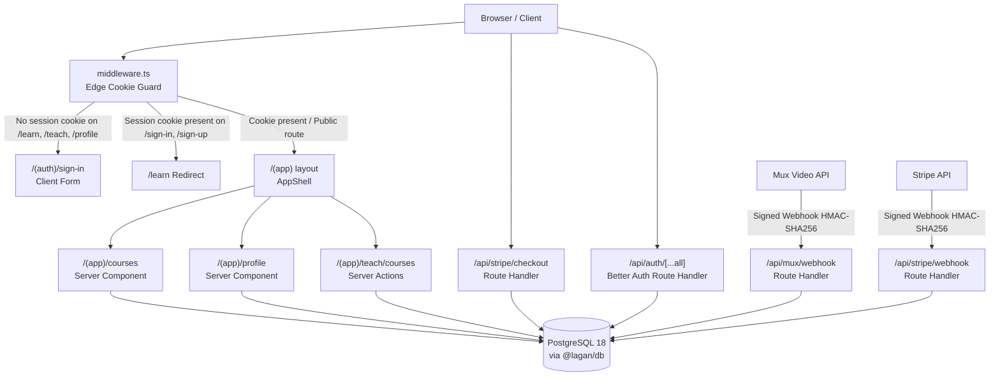
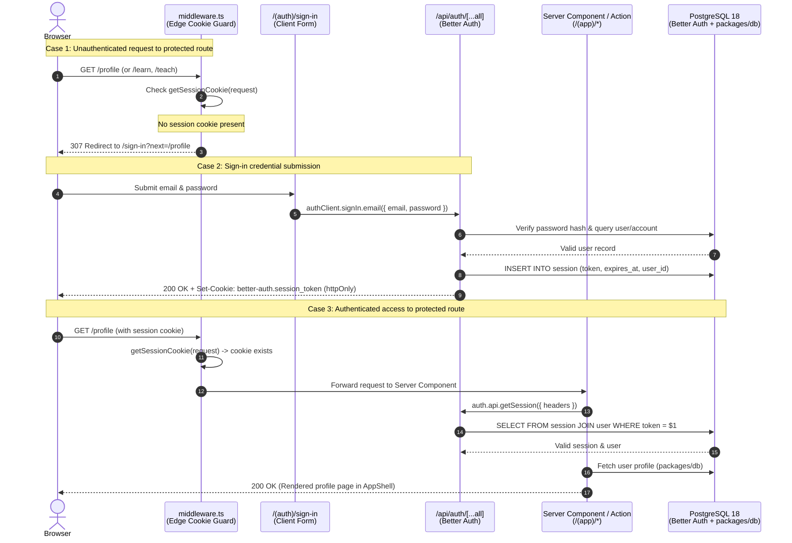

# Architecture

How the Lagan monorepo is put together, how a request travels through it, and where the
phase-6 real-time work will attach. Decisions behind these choices live in
[`adr/index.md`](adr/index.md) and [`stack.md`](stack.md).

## Overview

- **One deployable.** `apps/web` is a single Next.js 16.4.2 application (App Router,
  React 19.3, Turbopack). No microservices ([ADR-0001](adr/index.md)).
- **One database.** PostgreSQL 18 through Drizzle ORM 0.45; a `tenant_id` column on every
  institution table from the first migration ([ADR-0002](adr/index.md)). See
  [`data-model.md`](data-model.md).
- **Shared code as workspace packages.** `packages/{ui,types,db,config}` are consumed as
  TypeScript source, not as built artefacts.
- **Bun workspace.** Install and scripts run under Bun 1.4 (`bunfig.toml` sets
  `exact = true`, so dependency versions resolve exactly).

## Repository layout

| Path | Role | State |
|---|---|---|
| `apps/web` | The only deployable: App Router pages, route handlers, server actions, middleware. | Live |
| `packages/ui` | Client primitives and authoring widgets: sidebar, TipTap editor, HTML sanitizer, IndexedDB draft store. | Live |
| `packages/db` | Drizzle schema, migrations, queries, and types for `profiles`, `courses`, `modules`, `lessons`, `course_event`, `enrollments`, `lesson_progress`, `notifications`. | Live |
| `packages/types` | Shared domain types. | Placeholder — export list is empty |
| `packages/config` | Shared env and constants. | Placeholder — export list is empty |
| `tokens/tokens.json` | DTCG design tokens; source of truth ([ADR-0004](adr/index.md)). | Live |
| `scripts/gen-tokens.ts` | Generates `apps/web/app/tokens.css` from the tokens. | Live |
| `prototype/` | Static clickable design prototype (one HTML file, no build). | Design reference |
| `docs/` | This documentation tree. | Live |
| `docker-compose.yml` | Local Postgres 18 and MinIO. | Live |

Other root files that shape how the repo behaves:

| File | Effect |
|---|---|
| `tsconfig.base.json` | Shared compiler options: `strict`, `noUncheckedIndexedAccess`, `exactOptionalPropertyTypes`, `verbatimModuleSyntax`, `erasableSyntaxOnly`. Root script `bun run typecheck` runs `tsc --noEmit -p tsconfig.base.json`. |
| `apps/web/tsconfig.json` | The app's own config (does not extend the base): `jsx: react-jsx`, path alias `@/*` → `./*`. |
| `biome.json` | Lint and format, 2-space indent, 100 columns. |
| `lefthook.yml` | Pre-commit: format, lint, `cd apps/web && bunx next typegen && bunx tsc --noEmit`, and a 5000-token diff size guard. Pre-push: Vitest. |
| `vitest.config.ts` | jsdom environment; includes `packages/**/*.test.ts(x)` and `apps/**/*.test.ts(x)`. |
| `playwright.config.ts` | `testDir: ./apps/web/e2e`, Chromium, dev server `bun --cwd apps/web dev`. |
| `bunfig.toml` | `exact = true` for installs. |
| `.github/` | Issue templates, a PR template, and `workflows/ci.yml`. CI runs install, typecheck, test, lint and build on every push to `master` and on every pull request. |

## How `apps/web` consumes the workspace packages

1. Root `package.json` declares `workspaces: ["apps/*", "packages/*"]`; `bun install` links
   the packages into `node_modules`.
2. `apps/web/package.json` depends on them with `workspace:*`:

   ```json
   "@lagan/ui": "workspace:*",
   "@lagan/db": "workspace:*",
   "@lagan/types": "workspace:*"
   ```

3. Each package points `main` and `types` at source, so nothing is compiled before use:

   ```json
   "main": "./src/index.ts",
   "types": "./src/index.ts"
   ```

4. Consumers import from the package root, which re-exports its modules:

   ```ts
   import { profiles } from "@lagan/db";        // packages/db/src/index.ts
   import { Sidebar } from "@lagan/ui";         // packages/ui/src/index.ts
   ```

5. `moduleResolution: "Bundler"` in the base config lets TypeScript resolve those `.ts`
   entry points directly. Next.js and Vitest both compile the source in place.

Consequence: there is no per-package build or publish step today. A package's `src/` is its
public surface, and `packages/*/src/index.ts` is the barrel that defines it.

## Request path



Read the path top to bottom:

1. `apps/web/middleware.ts` runs on the matcher paths and makes an optimistic check.
2. Authenticated pages render inside the `(app)` group, whose layout wraps children in
   `AppShell` (`apps/web/app/(app)/shell.tsx`): sidebar, search field, category filter,
   notification and account buttons.
3. Data is read in server components and mutated in server actions, both of which
   re-check the session with `auth.api.getSession({ headers: await headers() })`.
4. Everything reaches Postgres through `apps/web/lib/db.ts` (one `pg.Pool` plus
   `drizzle(pool)`).
5. Third-party callbacks arrive as route handlers. `/api/mux/webhook` verifies the HMAC
   signature, then updates `lessons.mux_playback_id`.


### Auth request flow



## Routes and route groups

| URL | File | Group | Notes |
|---|---|---|---|
| `/` | `apps/web/app/page.tsx` | none | Still the `create-next-app` placeholder page. |
| `/courses` | `apps/web/app/(app)/courses/page.tsx` | `(app)` | Course catalog discovery, search query, category filter, and view toggle (P3.1, P3.5). |
| `/sign-in` | `apps/web/app/(auth)/sign-in/page.tsx` | `(auth)` | Client form, `react-hook-form` + Zod; honours `?next=`. |
| `/sign-up` | `apps/web/app/(auth)/sign-up/page.tsx` | `(auth)` | Same pattern. |
| `/profile` | `apps/web/app/(app)/profile/page.tsx` | `(app)` | Server component; redirects to `/sign-in` without a session. |
| `/api/auth/[...all]` | `apps/web/app/api/auth/[...all]/route.ts` | none | Better Auth mounted with `toNextJsHandler`. |
| `/api/stripe/checkout` | `apps/web/app/api/stripe/checkout/route.ts` | none | Creates authenticated Stripe checkout session (P3.3). |
| `/api/stripe/webhook` | `apps/web/app/api/stripe/webhook/route.ts` | none | Signed Stripe checkout completion webhook, grants enrollment (P3.3). |
| `/api/mux/webhook` | `apps/web/app/api/mux/webhook/route.ts` | none | Signed Mux event receiver. |
The two route groups carry different chrome and no URL segment of their own:

- **`(app)`** exists only to provide the shell. `apps/web/app/(app)/layout.tsx` is two lines:
  it renders `<AppShell>{children}</AppShell>`. The shell is a `"use client"` component
  because sidebar collapse and the category filter are client state.
- **`(auth)`** has no `layout.tsx`; each page is a self-contained full-screen card that pins
  itself with `min-h-screen` and reads the design tokens directly.

`/learn` and `/teach` appear in the middleware matcher. `/courses` is the live course discovery
surface (P3.1, P3.5), with `/learn` designated as the post-sign-in learner dashboard. `/teach` is
the authoring surface: `apps/web/app/(app)/teach/courses/` holds course CRUD server actions (P2.6)
and `apps/web/app/(app)/teach/courses/builder/` holds module and lesson CRUD with two-phase ordering
actions (P2.7). The paths are guarded today so the edge and server guards protect newly mounted
pages.

## Middleware: guards and the role split

`apps/web/middleware.ts` reads the session cookie with `getSessionCookie(request)` from
`better-auth/cookies`. Cookie presence is optimistic only: it is cheap enough for the edge
and cannot verify a signature, so every real authorization decision is repeated server-side.

| Condition | Action |
|---|---|
| Protected path without a session cookie | Redirect to `/sign-in?next=<pathname>` |
| `/sign-in` or `/sign-up` with a session cookie | Redirect to `/learn` |
| `/teach` | No-op placeholder; the comment states the real role check belongs in the server layout |

The matcher covers `/learn/:path*`, `/teach/:path*`, `/profile/:path*`, `/sign-in`,
`/sign-up`.

**Roles.** `apps/web/lib/roles.ts` is the whole role model at present:

```ts
export type Role = "student" | "instructor" | "ta" | "admin";
export function isInstructor(role: Role): boolean; // instructor | admin | ta
```

The learner/author split is therefore a predicate, not yet a database column: nothing reads
a role from a user record today, and no `role` column exists in `packages/db`. [ADR-0003](adr/index.md)
declares a wider role set (student, instructor, teaching assistant, administrator, external
examiner) than the union carries — the union is the four that the middleware and shell need,
and `external examiner` is not represented in code yet. Anything that gates on a role must
call `isInstructor` (or the same rule) rather than comparing to `"instructor"` directly, so
the TA and admin cases stay covered.

## Data access

| Concern | Location |
|---|---|
| Pool and Drizzle client | `apps/web/lib/db.ts` |
| Schema and row types | `packages/db/src/schema/*` re-exported from `packages/db/src/index.ts` |
| Auth server instance | `apps/web/lib/auth.ts` (`betterAuth` + `drizzleAdapter`, email + password, no social providers) |
| Auth client | `apps/web/lib/auth-client.ts` (`createAuthClient()`) |
| Session type | `export type Session = typeof auth.$Infer.Session` |

Better Auth owns its own tables (`user`, `session`, `account`, `verification`) at runtime.
`packages/db` mirrors only `user.id` as a foreign-key target, so the schema never drifts
against Better Auth's own migrations. Writes in this app then hang off that id, as
`profiles` does.

## Background work and external services

| Service | Purpose | State |
|---|---|---|
| PostgreSQL 18 | System of record; planned queue backend (pg-boss, [ADR-0006](adr/index.md)) | Local container; `pg-boss` is not a dependency yet |
| Mux | Video upload and playback ids | Implemented: `apps/web/lib/mux.ts` (direct upload, signature verification, event parsing) and `/api/mux/webhook`. Assets are created with `playback_policies: ["public"]`; signed playback waits for the entitlement work. |
| MinIO (S3 API) | Local object storage for submissions | Container only; no upload code yet ([ADR-0008](adr/index.md)) |
| Stripe | Paid checkout and webhook fulfillment | Implemented: `apps/web/lib/stripe.ts`, `/api/stripe/checkout`, `/api/stripe/webhook`, and `packages/db/src/schema/enrollment.ts` ([P3.3 #17](https://github.com/paramcodes/lagan/issues/17)) |
| Email | Notification delivery | Not implemented — [P6.4 (#34)](https://github.com/paramcodes/lagan/issues/34) |

Jobs must be idempotent and resumable, because a retry replays them.

## Notifications over SSE (Phase 6)

The architecture treats **stored database rows as the source of truth and SSE as a transport
over them**. The schema is merged (`packages/db/src/schema/notification.ts`, P6.1), while the
SSE streaming route, background worker, email integration, and shell notification centre UI
are tracked in the subsequent phase-6 deliverables:
| Step | Issue | Shape |
|---|---|---|
| Notification schema | [P6.1 (#31)](https://github.com/paramcodes/lagan/issues/31) | `notifications` table: recipient, type, JSONB payload, `read_at` (null = unread), `created_at`, `tenant_id`; index on `(user_id, read_at, created_at)` |
| SSE route + hook | [P6.2 (#32)](https://github.com/paramcodes/lagan/issues/32) | Authenticated route streams events for the signed-in user; client hook subscribes with reconnect and backoff, refetches missed rows on reconnect, falls back to `fetch` where SSE is unavailable; no unbounded server buffers |
| New-content detection | [P6.3 (#33)](https://github.com/paramcodes/lagan/issues/33) | An idempotent pg-boss job fans out notifications to enrolled learners when content is published, deduped per event, tenant-scoped; enqueues email |
| Email | [P6.4 (#34)](https://github.com/paramcodes/lagan/issues/34) | Delivery of the same event |
| Notification centre UI | [P6.5 (#35)](https://github.com/paramcodes/lagan/issues/35) | List, unread badge, read state |

Design consequences worth keeping in view:

- Read state is a column, not inferred from delivery. A dropped stream loses nothing: the
  client refetches on reconnect.
- The badge in `AppShell` is currently static markup; it becomes the SSE-fed unread count.
- Phase 6 depends on enrolment ([#18](https://github.com/paramcodes/lagan/issues/18)) for
  fan-out and on pg-boss, so it lands after phases 3–5.

## Related

- [`stack.md`](stack.md) — condensed stack decisions A1–A10 and open forks F1–F4.
- [`adr/index.md`](adr/index.md) — the ADR table.
- [`data-model.md`](data-model.md) — every table, column, key and constraint.
- [`design-system.md`](design-system.md) — tokens, `@theme`, shell chrome.
- [`contributing.md`](contributing.md) — setup, gates, commit rules.
