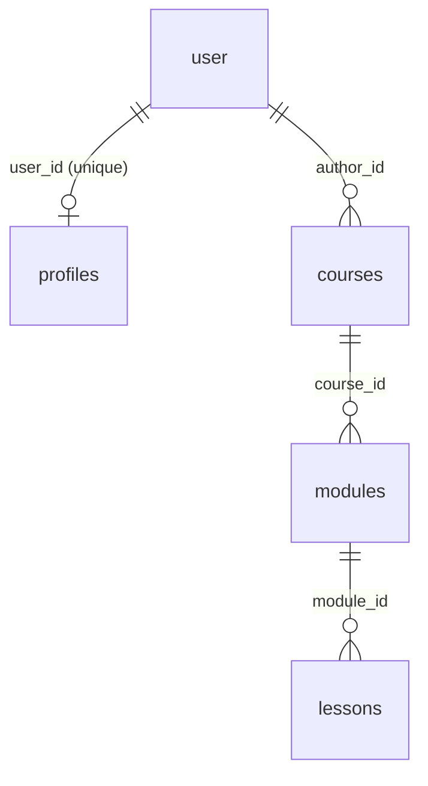

# Data model

Reference for the Drizzle schema in `packages/db`. Everything here is read from the schema
files, not from a database: the repository has no committed SQL migration yet.

Source files:

| File | Tables |
|---|---|
| `packages/db/src/schema/profile.ts` | `user` (mirror), `profiles` |
| `packages/db/src/schema/course.ts` | `courses`, `modules`, `lessons` |

Both are re-exported from `packages/db/src/index.ts`, which is what `apps/web` imports as
`@lagan/db`.

## Entity relationships

A lesson hangs off a module, never directly off a course, so reaching a course from a lesson
takes two joins. Deleting any parent removes its children (see
[Foreign keys](#foreign-keys-and-cascade-behaviour)).

## Conventions

**Identifiers.** Every primary key is `text`, holding a UUID the application generates
(`crypto.randomUUID()` in `apps/web/app/(app)/profile/actions.ts`). There is no
`defaultRandom()` and no database-side default, so an insert must supply an id.

**Naming.** Column names are explicit snake_case strings (`text("user_id")` → `user_id`);
the TypeScript properties are camelCase (`userId`). Every table exports singular aliases
alongside the plural binding, plus row types:

| Table | Bindings | Types |
|---|---|---|
| `profiles` | `profiles`, `profile`, `userProfiles`, `userProfile` | `Profile`, `NewProfile` |
| `courses` | `courses`, `course` | `Course`, `NewCourse` |
| `modules` | `modules`, `module` | `Module`, `NewModule` |
| `lessons` | `lessons`, `lesson` | `Lesson`, `NewLesson` |

**Timestamps.** `timestamp(name, { withTimezone: true })` → `timestamptz`, with
`.defaultNow().notNull()` where present. `lessons` has `updated_at` but no `created_at`.

**Tenancy.** `tenant_id` is required on every table that holds institution data, from the
first migration, per [ADR-0002](adr/index.md). `courses` is the only tenant-scoped table in
the schema today; `tenantId` is `text().notNull()` with no default and no foreign key,
because no `tenants` table exists (the tenancy model is open in
[ADR-0014](adr/index.md), fork F4). Nothing writes a course row yet — course CRUD is
[P2.6 (#10)](https://github.com/paramcodes/lagan/issues/10) — so no tenant value is produced
in practice. The column is in place so later work cannot forget it.

**Money.** Stored as integer cents: `courses.price_cents`, integer, not null, default `0`.
There is no currency column; the app is single-currency. Discounts are
`discount_percent` (integer, default `0`), and `is_free` is a separate boolean rather than a
sentinel price. No `CHECK` constraint guards either range, so `0 <= discount_percent <= 100`
is a convention the application must hold.

**Status and type columns.** `courses.status`, `lessons.status` and `lessons.type` are `text`
columns carrying a TypeScript union through `$type<...>()`. They are not `pgEnum` values:
the comment in `course.ts` records that the value set can then grow without a migration that
rewrites the type, and `erasableSyntaxOnly` in `tsconfig.base.json` forbids TypeScript
`enum` anyway. A consequence to respect: the database accepts any string in these columns.
There is no `CHECK` constraint, so the union is enforced only where the application validates.

| Union | Values | Used by |
|---|---|---|
| `CourseStatus` | `draft`, `published`, `archived` | `courses.status` |
| `LessonStatus` | `draft`, `published` | `lessons.status` |
| `LessonType` | `video`, `text`, `quiz`, `file`, `external` | `lessons.type` |
| `LessonContent` | `{ type: "doc"; content?: unknown[] }` | `lessons.content_json` |

## `user` (mirror)

A two-column-wide mirror of Better Auth's own table, present only so other tables have a
foreign-key target. Better Auth owns the real definition at runtime; this file declares the
id.

| Column | TS property | Type | Null | Default | Notes |
|---|---|---|---|---|---|
| `id` | `id` | `text` | no | — | Primary key |

## `profiles`

One row per user, created and updated through an upsert in
`apps/web/app/(app)/profile/actions.ts`.

| Column | TS property | Type | Null | Default | Notes |
|---|---|---|---|---|---|
| `id` | `id` | `text` | no | — | Primary key; `crypto.randomUUID()` on insert |
| `user_id` | `userId` | `text` | no | — | Unique. FK → `user.id`, `ON DELETE CASCADE` |
| `bio` | `bio` | `text` | yes | — | Empty string is normalised to `null` by the action |
| `website_url` | `websiteUrl` | `text` | yes | — | Validated as a URL or empty string by Zod |
| `social_links_json` | `socialLinksJson` | `text` | yes | — | Serialised `Array<{ label, url }>`. Text, not `jsonb`; parsed on read with a fallback to `[]` |
| `avatar_url` | `avatarUrl` | `text` | yes | — | |
| `created_at` | `createdAt` | `timestamptz` | no | `now()` | |
| `updated_at` | `updatedAt` | `timestamptz` | no | `now()` | The action sets this explicitly on update |

The unique constraint on `user_id` is what makes the write an upsert:
`onConflictDoUpdate({ target: profiles.userId, ... })`.

## `courses`

| Column | TS property | Type | Null | Default | Notes |
|---|---|---|---|---|---|
| `id` | `id` | `text` | no | — | Primary key |
| `tenant_id` | `tenantId` | `text` | no | — | No FK yet; see [Tenancy](#conventions) |
| `author_id` | `authorId` | `text` | no | — | FK → `user.id`, `ON DELETE CASCADE` |
| `title` | `title` | `text` | no | — | |
| `description` | `description` | `text` | yes | — | |
| `price_cents` | `priceCents` | `integer` | no | `0` | Money as integer cents |
| `discount_percent` | `discountPercent` | `integer` | no | `0` | Range enforced in app code only |
| `is_free` | `isFree` | `boolean` | no | `false` | |
| `status` | `status` | `text` (`CourseStatus`) | no | `'draft'` | |
| `version` | `version` | `integer` | no | `1` | Bumped on publish ([P2.10 #14](https://github.com/paramcodes/lagan/issues/14)) |
| `published_at` | `publishedAt` | `timestamptz` | yes | — | |
| `created_at` | `createdAt` | `timestamptz` | no | `now()` | |
| `updated_at` | `updatedAt` | `timestamptz` | no | `now()` | |

Indexes: `courses_tenant_id_idx`, `courses_author_id_idx`, `courses_status_idx` — one per
column that a list or filter query needs.

## `modules`

| Column | TS property | Type | Null | Default | Notes |
|---|---|---|---|---|---|
| `id` | `id` | `text` | no | — | Primary key |
| `course_id` | `courseId` | `text` | no | — | FK → `courses.id`, `ON DELETE CASCADE` |
| `title` | `title` | `text` | no | — | |
| `position` | `position` | `integer` | no | `0` | Ordering inside the course; unique per course |

Indexes: `modules_course_id_idx`, and unique `modules_course_id_position_key` on
`(course_id, position)`.

## `lessons`

| Column | TS property | Type | Null | Default | Notes |
|---|---|---|---|---|---|
| `id` | `id` | `text` | no | — | Primary key |
| `module_id` | `moduleId` | `text` | no | — | FK → `modules.id`, `ON DELETE CASCADE` |
| `type` | `type` | `text` (`LessonType`) | no | — | No default; the insert must choose |
| `title` | `title` | `text` | no | — | |
| `position` | `position` | `integer` | no | `0` | Ordering inside the module; unique per module |
| `status` | `status` | `text` (`LessonStatus`) | no | `'draft'` | Lessons publish individually, then with the course |
| `mux_playback_id` | `muxPlaybackId` | `text` | yes | — | Set by the Mux webhook on `video.asset.ready` |
| `content_json` | `contentJson` | `jsonb` (`LessonContent`) | yes | — | TiPTap document for `text` and `quiz` lessons |
| `external_url` | `externalUrl` | `text` | yes | — | For `external` lessons |
| `file_key` | `fileKey` | `text` | yes | — | Object-storage key for `file` lessons |
| `updated_at` | `updatedAt` | `timestamptz` | no | `now()` | No `created_at` column |

Indexes: `lessons_module_id_idx`, and unique `lessons_module_id_position_key` on
`(module_id, position)`.

The four payload columns are all nullable and none is tied to `type` by a constraint. Which
one a lesson uses is a convention: `content_json` for `text`/`quiz`, `mux_playback_id` for
`video`, `external_url` for `external`, `file_key` for `file`. The draft store in
`packages/ui/src/drafts.ts` mirrors exactly this shape.

## Foreign keys and cascade behaviour

| Child | Column | Parent | On delete | Effect of deleting the parent |
|---|---|---|---|---|
| `profiles` | `user_id` | `user.id` | `CASCADE` | Profile row disappears with the user |
| `courses` | `author_id` | `user.id` | `CASCADE` | **Every course by that user is deleted, and its modules and lessons with it** |
| `modules` | `course_id` | `courses.id` | `CASCADE` | Modules and their lessons are deleted |
| `lessons` | `module_id` | `modules.id` | `CASCADE` | Lesson rows are deleted |

All four cascades are asserted in `packages/db/src/schema/course.test.ts`, which reads the
table config rather than a live database. Note the author cascade: deleting an author's
account removes published courses. If authored content must outlive its author, that
constraint has to change (for example to `SET NULL` with a nullable `author_id`), and the
change is a schema migration, not an application concern.

## Uniqueness and ordering constraints

| Constraint | Table | Columns | Meaning |
|---|---|---|---|
| `profiles.user_id` unique | `profiles` | `user_id` | One profile per user |
| `modules_course_id_position_key` | `modules` | `(course_id, position)` | No two modules in a course share a position |
| `lessons_module_id_position_key` | `lessons` | `(module_id, position)` | No two lessons in a module share a position |

Consequences for authoring:

- Positions must be unique inside their parent, so a reorder has to renumber siblings rather
  than assign a duplicate position and swap afterwards.
- `position` defaults to `0`, so a naive two-insert sequence collides on the unique index
  until positions are set explicitly.
- Array index becomes `position` on publish: `packages/ui/src/drafts.ts` documents that the
  order an author sees in the builder is the order written to the column.

## Schema state and migrations

- Schema files exist; **no SQL migration is committed** and there is no `drizzle.config.ts`.
  `drizzle-kit` 0.31.11 is a devDependency, and ADR-0002 sets generated-then-reviewed SQL as
  the process. Until a migration lands, `packages/db` is the operative source of truth and
  the database can only be created through `drizzle-kit` run by hand.
- Better Auth's other tables (`session`, `account`, `verification`) are not declared here;
  they are created from Better Auth's own definition at runtime.
- `course.test.ts` is the pattern for schema tests: assert column names, nullability,
  defaults, foreign-key targets and cascades, and index uniqueness through
  `getTableColumns` / `getTableConfig`.

## Tables that do not exist yet

These are named deliberately: any feature work that reaches for them must add the table
first. Only `courses` carries `tenant_id` today, and each new institution table must carry
it too ([ADR-0002](adr/index.md)).

| Table | Purpose | Issue |
|---|---|---|
| `tenants` | The institution row `tenant_id` points at, with RLS policies | Tenancy model open: [ADR-0014](adr/index.md); no issue filed |
| `enrollments` (entitlements) | Access per `(user_id, course_id)`, granted on purchase or free enrol | [P3.4 (#18)](https://github.com/paramcodes/lagan/issues/18) |
| `lesson_progress` | Per-learner completion and playback position, unique on `(user_id, lesson_id)` | [P4.2 (#24)](https://github.com/paramcodes/lagan/issues/24) |
| `course_event` | Append-only learner activity for author analytics: `type` in `view \| progress \| complete \| drop` | [P5.1 (#47)](https://github.com/paramcodes/lagan/issues/47) |
| `notifications` | Durable notification rows: recipient, type, JSONB payload, `read_at`, `created_at` | [P6.1 (#31)](https://github.com/paramcodes/lagan/issues/31) |

Also absent: any table for submissions or uploaded files ([ADR-0008](adr/index.md) covers the
storage shape, not the rows), and any audit or event log.

## Adding a table

1. Add `packages/db/src/schema/<name>.ts`, following `course.ts`: explicit snake_case names,
   `text` primary key, `tenant_id` if it holds institution data, cascading foreign keys.
2. Re-export it from `packages/db/src/index.ts`.
3. Add a test alongside it in the style of `course.test.ts`.
4. Generate the migration and review the SQL ([ADR-0002](adr/index.md)).
5. Run the gates in [`contributing.md`](contributing.md).

## Related

- [`architecture.md`](architecture.md) — how the app reaches this schema at runtime.
- [`adr/index.md`](adr/index.md) — ADR-0002 (Postgres, tenancy), ADR-0008 (submissions).
- [`contributing.md`](contributing.md) — database rules and gates.
