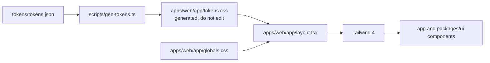

# Design system

The design system is a DTCG token file plus a generator. Tailwind is a compile target, not
the source: a colour exists only in `tokens/tokens.json` ([ADR-0004](adr/index.md)). This page
documents the pipeline, the token set as it stands, dark mode, and the primitives shipped
from `packages/ui`.

## Pipeline



| Step | File | What happens |
|---|---|---|
| 1 | `tokens/tokens.json` | Hand-edited. DTCG shape: groups of `{ "$type", "$value" }`. |
| 2 | `bun run gen:tokens` | Runs `scripts/gen-tokens.ts`. |
| 3 | `apps/web/app/tokens.css` | Written by the script. Carries a `/* AUTO-GENERATED ... Do not edit. */` header. |
| 4 | `apps/web/app/layout.tsx` | Imports `./globals.css` and `./tokens.css`, in that order. |
| 5 | `apps/web/next.config.ts` | Turbopack rule loads `@tailwindcss/turbopack` for `*.css`. |
| 6 | components | Read the emitted custom properties. |

### What the generator does

`scripts/gen-tokens.ts` walks the token tree recursively, joining each key path with `-`
(`color.ink2` → `color-ink2`) and emitting two blocks:

```css
/* AUTO-GENERATED from tokens/tokens.json. Do not edit. */
:root {
  --color-ink: #0C0D0C;
  --radius-panel: 14px;
  --font-sans: Archivo, system-ui, sans-serif;
  /* ...one line per token */
}

@theme inline {
  --color-color-ink: var(--color-ink);
  --color-radius-panel: var(--radius-panel);
  --color-font-sans: var(--font-sans);
  /* ...one line per token */
}
```

Two consequences of that mapping are worth knowing before you reach for a utility class:

- The `@theme` alias is always prefixed `--color-`, so the colour group double-prefixes to
  `--color-color-ink`, and the radius and font tokens are aliased under `--color-` too. That
  is why app code reads the `:root` properties through arbitrary values
  (`bg-[var(--color-canvas)]`) rather than using generated colour utilities.
- The single source for a value is the `:root` block. Editing `tokens.css` by hand loses the
  change on the next `gen:tokens` run.

### Adding or changing a token

1. Edit `tokens/tokens.json` only.
2. Run `bun run gen:tokens`.
3. Commit the JSON and the regenerated `apps/web/app/tokens.css` together.

`contributing.md` states that CI fails when the generated file drifts. The CI workflow
(`.github/workflows/ci.yml`) runs install, typecheck, test, lint and build on push to
`master` and on every pull request, but it never regenerates the tokens or diffs the
output, so drift is still caught in review rather than by a pipeline.

## Tokens

### Colour

| Token | Value | Role in the product |
|---|---|---|
| `ink` | `#0C0D0C` | Primary text; headings. |
| `ink2` | `#171817` | Hover and active states inside dark chrome. |
| `canvas` | `#F4F4F2` | Page background. |
| `surface` | `#FFFFFF` | Panels, cards, tables. |
| `line` | `#E0E1DE` | Decoration: panel edges, table rules. Not for operable boundaries. |
| `edge` | `#7C7E77` | Boundary of anything operable: inputs, chips, outline buttons. |
| `brand` | `#111311` | Institutional colour; primary actions. Painted on the sign-in button. |
| `chalk` | `#F2E679` | The only loud colour; reserved for position ("you are here"). |
| `due` | `#8A5200` | Something is due soon. Reserved for time. |
| `alert` | `#A62B22` | Overdue, missing, or an invalid field. |
| `accent` | `#4F46E5` | Indigo accent: links and the focus border on form controls. |

Amber (`due`) and red (`alert`) are reserved for time and error. Chalk is the only other
chroma and is reserved for position. Nothing else may introduce a colour.

### Radius

| Token | Value | Applies to |
|---|---|---|
| `radius-panel` | `14px` | Panels and cards. |
| `radius-control` | `10px` | Inputs, buttons. |
| `radius-chip` | `7px` | Chips and small markers. |

A panel at rest gets a hairline border, never a shadow; only things that genuinely float
(menus, popovers) cast one.

### Type

| Token | Value |
|---|---|
| `font-sans` | `Archivo, system-ui, sans-serif` |

One family, four tempos: 600 names and headline figures, 500 controls, 400 reading, tabular
for every number. Display and heading sizes are tracked tighter than body (−2.8% to −3%).

**Known gap.** The font story is not yet consistent in code. `tokens.json` declares Archivo,
`apps/web/app/layout.tsx` loads Geist and Geist Mono through `next/font` as
`--font-geist-sans` / `--font-geist-mono`, and `globals.css` aliases `--font-sans` to
`--font-geist-sans` while setting `body { font-family: Arial, Helvetica, sans-serif }`. The
token file remains the stated source of truth; treat the font wiring as unfinished rather
than as a decision.

### `--line` and `--edge`

Two line tokens exist because decoration and operable boundaries have different contrast
obligations:

- `--line` is 1.3:1 on white. It is decoration (panel edges, table rules) and is exempt from
  contrast requirements.
- `--edge` is 3.4:1 on white, which clears WCAG 2.1 SC 1.4.11 for the boundary of an
  operable control.

Rule: if the line is how a user finds the control, it is `--edge`. If it separates two
surfaces, it is `--line`. The build target is WCAG 2.2 AA with a 2.1 AA legal floor
([ADR-0010](adr/index.md)); body text clears 4.5:1.

### Not yet tokenised

`prototype/README.md` documents a wider palette than `tokens.json` carries. These values are
design intent today, not tokens, and using one in app code means adding it to the token file
first:

| Prototype name | Value | Purpose |
|---|---|---|
| Brand soft | `#E9EAE7` | Course codes, completed markers |
| Due fill | `#FBEFD6` | Background behind `due` text |
| Alert fill | `#FAE7E4` | Background behind `alert` text |
| Muted | `#6E706C` | Secondary text that clears 4.5:1 on the canvas |

## Dark mode

Dark mode is **system-preference only** and is carried by Tailwind's `dark:` variant, not by
tokens:

| Layer | Current behaviour |
|---|---|
| `globals.css` | Defines `--background` / `--foreground`, duplicated inside a `@media (prefers-color-scheme: dark)` block. |
| Components | Pair light utilities with `dark:` variants, e.g. `bg-zinc-50 dark:bg-zinc-950`, `border-zinc-200 dark:border-zinc-800`. |
| Tokens | No dark values. `tokens.css` has no media query and no `.dark` block. |
| Toggle | None. There is no `class="dark"` strategy and no theme switcher. |

So: the app follows the operating system, and the dark palette is written per component in
Tailwind's zinc scale rather than from tokens. Adding a manual toggle means deciding where
dark token values live (a `dark` group in `tokens.json`, or a CSS override block) before
wiring any switch.

## Neutrals in practice

Two neutral systems are in use:

| Where | Neutrals |
|---|---|
| `(app)` shell, sidebar, auth pages | Tailwind `zinc` utilities (`zinc-50` … `zinc-950`) paired with `dark:` variants |
| `(auth)` pages, token consumers | The token values: `canvas`, `surface`, `line`, `edge`, `ink` |

The tokens (a warm working grey, not sludge) are the intended palette; the shell has not
been migrated onto them yet. New work should use the token values, and passing the shell
over is tracked as part of the docs-and-polish phase rather than as a redesign.

## Usage in components

Tokens are read as CSS custom properties, which works in both server and client components:

```tsx
<div className="flex min-h-screen items-center justify-center bg-[var(--color-canvas)] px-4">
  <div className="w-full max-w-sm rounded-[var(--radius-panel)] border border-[var(--color-line)] bg-[var(--color-surface)] p-6 shadow-sm">
    <h1 className="text-xl font-semibold text-[var(--color-ink)]">Sign in</h1>
    <input className="rounded-[var(--radius-control)] border border-[var(--color-line)] focus:border-[var(--color-accent)]" />
    <p className="text-sm text-[var(--color-alert)]">Invalid credentials</p>
  </div>
</div>
```

That snippet is the live pattern from `apps/web/app/(auth)/sign-in/page.tsx`: panel on
`canvas`, `surface` inside, `line` for the border, `accent` on focus, `alert` for errors.
Note that form controls use `--line` here rather than `--edge`; the prototype's accessibility
audit states controls should use `--edge`, so this is a defect to fix when the auth pages are
revisited.

## Sidebar

`packages/ui/src/sidebar.tsx` is the one shell primitive another app would reuse.

| Property | Value |
|---|---|
| Expanded width | `260px` |
| Collapsed width | `64px` |
| Transition | `width 200ms ease-out` (class `transition-[width]`) |
| Applied twice | Inline `style={{ width }}` plus `w-[260px]` / `w-[64px]` |
| State attribute | `data-state="expanded" \| "collapsed"` on the `<aside>`, plus `data-sidebar` |
| Collapse control | Icon button (`PanelLeftOpen` / `PanelLeftClose`), label from `toggleLabel` |
| Active item | `aria-current="page"` |

| Prop | Type | Default | Notes |
|---|---|---|---|
| `items` | `SidebarNavItem[]` | `DEFAULT_ITEMS` | `{ label, href?, icon?, active?, onClick? }`. Renders `<a>` when `href` is set, otherwise `<button>`. |
| `collapsed` | `boolean` | — | Controlled value. Leaving it `undefined` switches to internal state. |
| `defaultCollapsed` | `boolean` | `false` | Uncontrolled initial value. |
| `onCollapsedChange` | `(collapsed: boolean) => void` | — | Fires on every toggle. |
| `onToggle` | `(collapsed: boolean) => void` | — | Same payload; kept for callers that only want the event. |
| `header` / `footer` | `ReactNode` | — | Header renders only when expanded. |
| `className` | `string` | — | Appended to the base classes. |
| `toggleLabel` | `string` | `"Toggle sidebar"` | Accessible name of the collapse button. |

`AppShell` (`apps/web/app/(app)/shell.tsx`) owns collapse state and passes it down, so the
header search field, category filter and the two icon buttons sit beside the sidebar in one
client component. Aliases exported: `SidebarNav`, `SidebarItem`, `NavItem`, and `Sidebar` as
default.

## Primitives from `packages/ui`

`packages/ui/src/index.ts` re-exports four modules. There is no component kit in the
dependency list yet — `@base-ui/react` and React Aria ([ADR-0005](adr/index.md)) are not
installed, and the current dependencies are `lucide-react`, TipTap 3.32, `idb-keyval`,
`zustand` 5 and `isomorphic-dompurify`.

| Module | Exports | Purpose |
|---|---|---|
| `sidebar.tsx` | `Sidebar`, `SidebarNav`, `SidebarNavItem`, `SidebarProps` | Collapsible rail described above. |
| `editor.tsx` | `RichTextEditor`, `RichTextEditorProps`, `EditorSnapshot` | TipTap StarterKit editor with a toolbar; `"use client"`. |
| `sanitize.ts` | `sanitizeHtml` | DOMPurify allowlist matching the editor's tags; forces `rel="noopener noreferrer"` on `target="_blank"` links; idempotent, safe on read and write. |
| `drafts.ts` | `createDraftStore`, `useDraftStore`, `createDraftStorage`, `createMemoryStorage`, `createCourseDraft`, `createModuleDraft`, `createLessonDraft`, `selectDraft`, `selectActiveDraft`, `selectDraftList`, draft types | Local-first course builder state in IndexedDB via `zustand/persist`; mirrors the `packages/db` course rows. |

Adding a primitive: it lives in `packages/ui/src` and is re-exported from
`packages/ui/src/index.ts`. Anything with hooks or browser APIs starts with `"use client"`,
because the package is compiled as source inside the app.

## Checks

| Check | Command | State |
|---|---|---|
| Token regeneration | `bun run gen:tokens` | Manual |
| Generated-file drift | — | Not enforced: CI does not regenerate the tokens |
| Contrast | — | Not enforced in CI; the prototype audit is the source of the measured values |
| Accessibility | `bun run test:e2e` (Playwright) | Only the home-page smoke test exists; axe is planned ([P7.2 #37](https://github.com/paramcodes/lagan/issues/37)) |

## Related

- [`architecture.md`](architecture.md) — where the shell and route groups sit.
- [`adr/index.md`](adr/index.md) — ADR-0004 (tokens), ADR-0005 (UI behaviour), ADR-0010 (accessibility).
- [`contributing.md`](contributing.md) — token edit rules.
- `prototype/README.md` — the palette, type and shape rationale the tokens were frozen from.
