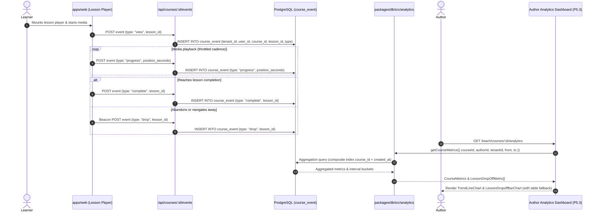

# Feature — author analytics

Status: **partly built**. The event telemetry schema (`course_event`, P5.1) is **merged** in commit `96ea406` (PR #49). The token-styled accessible chart components (`packages/ui/src/charts/`, P5.4) are **merged** in commit `920c782` (PR #63). The aggregation queries (`packages/db/src/analytics.ts`, P5.2) are **implemented** in PR #66. The author analytics dashboard UI (`apps/web/app/(app)/teach/courses/[id]/analytics/`, P5.3) is **planned**.

Cross-links: [architecture](../architecture.md), [data model](../data-model.md), [course authoring](./authoring.md), [player and progress](./player-progress.md), [payments and enrollments](./payments.md), [discovery](./discovery.md), [learner and author profiles](./profiles.md), [ADR-0002 (Postgres / Tenancy)](../adr/index.md), [ADR-0010 (Accessibility)](../adr/index.md), [ADR-0014 (Tenancy model)](../adr/index.md), [2026 Stack Decisions](../decisions/2026-stack-decisions.md).

---

## Status by item

| Item | What | State | Evidence |
|---|---|---|---|
| P5.1 | `course_event` schema & index migration | **merged** | `packages/db/src/schema/event.ts`, `event.test.ts` (#49) |
| P5.2 | Event aggregation & trend queries | **implemented** | `packages/db/src/analytics.ts`, tests in PR #66 |
| P5.3 | Author analytics dashboard UI | planned | `apps/web/app/(app)/teach/courses/[id]/analytics/` (#52) |
| P5.4 | Token-styled accessible chart primitives | **merged** | `packages/ui/src/charts/`, `chart.test.tsx` (#63) |

---

## System architecture & telemetry pipeline

Lagan separates operational state (`enrollments`, `lesson_progress`) from append-only analytical events (`course_event`). The operational tables record current learner progress and entitlement state. The event stream records temporal actions to compute conversion, retention, drop-off, and temporal velocity for instructors.



---

## Core metrics definitions & mathematical models

Every metric in the analytics suite is defined with strict mathematical invariants to ensure consistent reporting across dashboard views, summary cards, and time-series charts.

### 1. Enrolments ($E$)

The total number of learners who have acquired access to the course within the queried timeframe.

$$\text{Enrolments}(t_{\text{from}}, t_{\text{to}}) = \sum [e \in \text{enrollments} \mid e.\text{course\_id} = C \land t_{\text{from}} \le e.\text{enrolled\_at} \le t_{\text{to}}]$$

- **Lifetime enrolments (`totalEnrolments`)**: The cumulative count of all enrollment records across all time.
- **Windowed enrolments (`enrolments`)**: The count of enrollment records whose `enrolled_at` timestamp falls within the filter window $[t_{\text{from}}, t_{\text{to}}]$.
- **Data source**: `enrollments` table, keyed on `course_id`.

### 2. Course starts ($S$)

The count of **distinct learners** who initiated learning activity within the course. A start is identified when a learner triggers at least one `view` event on any lesson or the course root.

$$\text{Starts}(t_{\text{from}}, t_{\text{to}}) = |\{ u \in \text{users} \mid \exists e \in \text{course\_event} : e.\text{user\_id} = u \land e.\text{course\_id} = C \land e.\text{type} = \text{'view'} \land t_{\text{from}} \le e.\text{created\_at} \le t_{\text{to}} \}|$$

- **Why distinct users**: A learner opening five lessons in a day represents one learner start, preventing session reloads from artificially inflating active student counts.
- **Distinction from enrolments**: Enrolment represents financial or administrative acquisition; Starts represents pedagogical engagement. The difference ($E - S$) measures dormant or unstarted purchases.

### 3. Course completions ($C$)

The count of **distinct learners** who completed the entire course curriculum. A course completion event is recorded with `type = 'complete'` and a `NULL` `lesson_id`.

$$\text{Completions}(t_{\text{from}}, t_{\text{to}}) = |\{ u \in \text{users} \mid \exists e \in \text{course\_event} : e.\text{user\_id} = u \land e.\text{course\_id} = C \land e.\text{type} = \text{'complete'} \land e.\text{lesson\_id} \text{ IS NULL} \land t_{\text{from}} \le e.\text{created\_at} \le t_{\text{to}} \}|$$

- **Lesson vs course completion**: An event where `lesson_id IS NOT NULL` tracks completion of a specific lesson component. Only events with `lesson_id IS NULL` signify course-level completion.

### 4. Course completion rate ($R_c$)

The ratio of learners who completed the course to the learners who actively started it.

$$R_c = \begin{cases} \frac{C}{S} & \text{if } S > 0 \\ 0 & \text{if } S = 0 \end{cases}$$

- **Why $S$ is the denominator (not $E$)**: Using starts ($C / S$) isolates educational effectiveness and curriculum retention from purchase conversion. Calculating completion against total enrollments ($C / E$) conflates learner disengagement with buyers who never began the first module.
- **Zero-handling**: If $S = 0$, $R_c$ is strictly evaluated to `0` (or `0.0%`), preventing division-by-zero errors or IEEE 754 `NaN` values from propagating into UI calculation or formatting helpers.
- **Anomalies and bounds**: In standard operation, $0 \le R_c \le 1.0$ ($0\%$ to $100\%$). If windowing filters capture completions from learners whose start occurred before $t_{\text{from}}$, the query window isolates events within the interval; lifetime views clamp to $1.0$.

### 5. Per-lesson drop-off & drop-off rate ($R_{d, l}$)

Per-lesson drop-off measures student attrition at each instructional unit, pinpointing friction points, excessively difficult assignments, or unengaging video modules.

For any published lesson $l$ in course $C$:
- **Lesson Views ($V_l$)**: Count of distinct learners with a `view` event on lesson $l$.
- **Lesson Completions ($C_l$)**: Count of distinct learners with a `complete` event on lesson $l$.
- **Lesson Drop-offs ($D_l$)**: Count of distinct learners who abandoned or exited the course at lesson $l$ (`type = 'drop'` with `lesson_id = l.id`).

$$\text{Drop-off Rate } (R_{d, l}) = \begin{cases} \frac{D_l}{V_l} & \text{if } V_l > 0 \\ 0 & \text{if } V_l = 0 \end{cases}$$

- **Zero-handling**: When a new or unviewed lesson has $V_l = 0$, $R_{d, l}$ evaluates to `0`.
- **Sequential funnel attrition**: Across sequential lessons $l_1, l_2, \dots, l_n$, the step drop-off between consecutive lessons is computed as:

$$\Delta_{\text{step}}(l_k \to l_{k+1}) = \max(0, V_{l_k} - V_{l_{k+1}})$$

---

## Event tracking model — `course_event`

The `course_event` table (`packages/db/src/schema/event.ts`) is an append-only transaction ledger capturing granular learner interactions.

### Relational schema definition

```ts
export type CourseEventType = "view" | "progress" | "complete" | "drop";

export const courseEvent = pgTable(
  "course_event",
  {
    id: text("id").primaryKey(),
    // ADR-0002: every table holding institution data carries tenant_id from migration one.
    tenantId: text("tenant_id").notNull(),
    userId: text("user_id")
      .notNull()
      .references(() => user.id, { onDelete: "cascade" }),
    courseId: text("course_id")
      .notNull()
      .references(() => courses.id, { onDelete: "cascade" }),
    // Nullable: a "drop" or "complete" event can fire at course level, with no lesson in focus.
    lessonId: text("lesson_id").references(() => lessons.id, { onDelete: "cascade" }),
    type: text("type").$type<CourseEventType>().notNull(),
    positionSeconds: integer("position_seconds").notNull().default(0),
    createdAt: timestamp("created_at", { withTimezone: true }).defaultNow().notNull(),
  },
  (table) => [
    index("course_event_tenant_id_idx").on(table.tenantId),
    index("course_event_user_id_idx").on(table.userId),
    index("course_event_course_id_idx").on(table.courseId),
    index("course_event_lesson_id_idx").on(table.lessonId),
    index("course_event_course_id_created_at_idx").on(table.courseId, table.createdAt),
  ],
);
```

### Event types and semantics

| `type` | `lesson_id` | Semantics | Primary use |
|---|---|---|---|
| `view` | `NULL` | Learner visited the course overview / table of contents | General course interest |
| `view` | Set | Learner entered and mounted the lesson player | Lesson start / denominator for lesson drop-off |
| `progress` | Set | Periodic playback position update (`position_seconds`) | Scrubbing, engagement depth, video watch time |
| `complete` | Set | Learner met completion threshold for the lesson | Lesson funnel conversion ($C_l$) |
| `complete` | `NULL` | Learner finished all required lessons in the course | Course completion ($C$) |
| `drop` | Set | Learner exited, closed tab, or bounced during this lesson | Lesson friction / drop-off numerator ($D_l$) |
| `drop` | `NULL` | Learner explicitly abandoned or dropped course enrollment | Course-level attrition |

### Extensible payload model & JSONB evolution

The current schema prioritizes lean, predictable row sizing and fast index inserts by storing `type`, `lesson_id`, and `position_seconds` as direct relational columns. For rich telemetry, the schema accommodates an extensible JSONB payload without breaking existing query indexes:

```ts
// Planned telemetry payload representation for rich events
export interface CourseEventPayload {
  clientSessionId?: string;
  playbackRate?: number;
  totalDurationSeconds?: number;
  seekCount?: number;
  deviceType?: "desktop" | "mobile" | "tablet";
  sourceReferrer?: string;
}
```

- **Storage efficiency**: High-frequency heartbeat ticks (`progress`) generate substantial row volume. Storing `position_seconds` as an `integer` requires 4 bytes on disk, avoiding JSONB parsing and decompression overhead during range aggregations.
- **Payload containment**: When arbitrary metadata is added (`payload: jsonb("payload")`), it carries non-indexed operational context (user agent strings, screen dimensions, audio track language) while core aggregation filters operate on typed relational columns.

### Multi-tenancy & author scoping

Author analytics enforces strict data isolation at two hierarchical boundaries:

1. **Tenant boundary (ADR-0002 & ADR-0014)**:
   Every query mandates `course_event.tenant_id = :tenantId`. Events cannot be read or aggregated across tenant boundaries, preventing institution data leaks in shared-database deployments.
2. **Author ownership boundary**:
   Instructors may only inspect metrics for courses they own. Before executing aggregation queries, the database verifies course authorship:

```ts
const [course] = await db
  .select({ id: courses.id })
  .from(courses)
  .where(
    and(
      eq(courses.id, options.courseId),
      eq(courses.authorId, options.authorId),
      eq(courses.tenantId, options.tenantId),
    ),
  );

if (!course) {
  return null; // Deny access / course not found
}
```

Attempts by an author to query another instructor's course ID return `null` (rendering a 404 or 403 in the dashboard route), neutralizing Insecure Direct Object Reference (IDOR) vulnerabilities.

---

## Aggregation query architecture & windowing

Analytics queries live in `packages/db/src/analytics.ts` and operate over four primary access patterns:

1. `getCourseMetrics`: Single-course high-level summary cards.
2. `getAuthorCoursesMetrics`: Multi-course catalog summary for the author home.
3. `getLessonDropOffMetrics`: Sequential per-lesson funnel metrics.
4. `getCourseTrendMetrics`: Time-series trend bucketing (`day`, `week`, `month`).

### Windowing contracts and interval definitions

```ts
export interface DateWindow {
  from?: Date | string | null;
  to?: Date | string | null;
}

export type TrendInterval = "day" | "week" | "month";

export interface CourseTrendOptions extends DateWindow {
  authorId: string;
  tenantId: string;
  courseId: string;
  interval?: TrendInterval;
}
```

- **Timezone consistency**: Timestamps are stored in UTC (`timestamptz`). Date inputs (`from`, `to`) are parsed to standard `Date` instances. Invalid date representations are discarded (`undefined`) rather than producing malformed SQL queries.
- **Date trunc aggregation**: SQL `date_trunc('day' | 'week' | 'month', created_at)` buckets records into chronological slots for time-series visualizations.

### Single-course metrics aggregation

`getCourseMetrics` combines windowed `enrollments` counts with `course_event` aggregations in parallel database queries:

```sql
-- Enrolments query
SELECT coalesce(count(id), 0)::int AS total
FROM enrollments
WHERE course_id = :courseId
  AND (:from::timestamptz IS NULL OR enrolled_at >= :from)
  AND (:to::timestamptz IS NULL OR enrolled_at <= :to);

-- Event metrics query
SELECT
  coalesce(count(distinct case when type = 'view' then user_id end), 0)::int AS starts,
  coalesce(count(distinct case when type = 'complete' and lesson_id is null then user_id end), 0)::int AS completions,
  coalesce(count(distinct case when type = 'drop' and lesson_id is null then user_id end), 0)::int AS drop_offs
FROM course_event
WHERE course_id = :courseId
  AND tenant_id = :tenantId
  AND (:from::timestamptz IS NULL OR created_at >= :from)
  AND (:to::timestamptz IS NULL OR created_at <= :to);
```

### Zero-handling and temporal gap filling

Raw SQL `GROUP BY date_trunc(...)` statements only return buckets for periods containing recorded events. If a course had no active learners on Tuesday and Wednesday, a raw query skips those dates entirely.

To prevent line charts from deceptively connecting disconnected dates, `packages/db/src/analytics.ts` reconciles enrollment and event streams into a unified bucket map:

```ts
export function calculateCompletionRate(completions: number, starts: number): number {
  if (starts <= 0 || !Number.isFinite(starts)) return 0;
  if (completions <= 0 || !Number.isFinite(completions)) return 0;
  return completions / starts;
}

export function calculateDropOffRate(dropOffs: number, views: number): number {
  if (views <= 0 || !Number.isFinite(views)) return 0;
  if (dropOffs <= 0 || !Number.isFinite(dropOffs)) return 0;
  return dropOffs / views;
}
```

- **Division-by-zero protection**: `calculateCompletionRate` and `calculateDropOffRate` explicitly verify denominator positivity ($> 0$) and finiteness, returning `0` on empty data sets.
- **Sparse data normalization**: When `enrollmentRows` and `eventRows` are returned, buckets are joined by ISO timestamp keys. Buckets with enrollments but zero events (or vice versa) initialize missing dimensions to `0`.

### Indexing strategy & execution characteristics

The schema includes targeted composite and single-column indexes:

1. `course_event_course_id_created_at_idx`:
   Composite index on `(course_id, created_at)`. Allows PostgreSQL to perform bounded index range scans when evaluating date windows (`created_at >= from AND created_at <= to`), eliminating full table scans.
2. `course_event_tenant_id_idx`:
   Filters tenant data during multi-tenant maintenance and partition pruning.
3. `course_event_lesson_id_idx`:
   Accelerates `getLessonDropOffMetrics` joins when mapping lesson events back to course curriculum order.
4. `enrollments_course_id_idx`:
   Provides fast point lookups for course enrollment tallies.

---

## Chart component integration — `packages/ui/src/charts/`

Author analytics visualizes metric trends using token-styled chart components merged in PR #63.

```
packages/ui/src/charts/
├── accessible-chart.tsx        # High-order container with semantic table fallback
├── bar-chart.tsx               # Categorical single/multi bar chart
├── chart-card.tsx              # Panel wrapper with metric callout and header action
├── index.ts                    # Module exports
├── lesson-dropoff-bar-chart.tsx# Horizontal/vertical attrition visualization
├── trend-line-chart.tsx        # SVG line chart with area gradient
└── types.ts                    # Shared types & default token fallbacks
```

### Pure SVG architecture & design token alignment

The charts require **zero external charting libraries** (no D3, Chart.js, or Recharts dependencies). Rendering is executed via pure React SVG elements, guaranteeing zero runtime bloat, fast initial server render, and exact theme matching via DTCG design tokens.

```css
/* DTCG tokens referenced by chart components */
:root {
  --color-primary: var(--color-brand, #111311);
  --color-accent: var(--color-accent, #4F46E5);
  --color-muted: var(--color-edge, #7C7E77);
  --color-line: var(--color-line, #E0E1DE);
  --color-surface: var(--color-surface, #FFFFFF);
  --color-canvas: var(--color-canvas, #F4F4F2);
  --color-alert: var(--color-alert, #A62B22);
}
```

### Component catalogue

#### 1. `TrendLineChart` (`trend-line-chart.tsx`)

Renders time-series velocity (e.g. daily enrollments, active learner starts, completion velocity).

- **Area gradient**: Smooth SVG linear gradient fading from `--color-accent` at $0.25$ opacity to $0.00$ at base.
- **Dynamic coordinate mapping**: Normalizes dynamic data ranges to a fixed viewBox (`600 x 240`) with configured padding (`{ top: 20, right: 30, bottom: 40, left: 50 }`).
- **Edge cases**: Handles empty data arrays with an empty status notice, single data points with a centered horizontal reference line, and flat values ($y_{\min} = y_{\max}$) by centering the horizontal plot.

```tsx
<TrendLineChart
  title="Weekly Enrollments"
  description="Daily new student enrollments"
  data={[
    { label: "Mon", value: 12 },
    { label: "Tue", value: 24 },
    { label: "Wed", value: 18 },
    { label: "Thu", value: 36 },
  ]}
  valueFormatter={(v) => `${v} students`}
  showDots={true}
  showArea={true}
/>
```

#### 2. `LessonDropoffBarChart` (`lesson-dropoff-bar-chart.tsx`)

Visualizes student progression and attrition through sequential curriculum lessons.

- **Dual metric bars**: Displays completed learners alongside drop-off volume for each lesson.
- **Automatic drop-off highlight**: Automatically scans points to identify the lesson with the highest drop-off rate, summarizing it in generated screen-reader descriptions (e.g. *"Highest drop-off: Lesson 3 with 35.0% drop-off, 14 dropped"*).
- **Flexible orientation**: Defaults to `horizontal` for legible lesson titles on desktop and mobile viewports; supports `vertical` for summary cards.

```tsx
<LessonDropoffBarChart
  title="Curriculum Drop-off"
  data={[
    { lessonTitle: "1. Welcome & Setup", completedCount: 120, droppedCount: 4 },
    { lessonTitle: "2. Core Principles", completedCount: 110, droppedCount: 10 },
    { lessonTitle: "3. Advanced Practice", completedCount: 75, droppedCount: 35 },
  ]}
  rateFormatter={(rate) => `${rate.toFixed(1)}%`}
/>
```

#### 3. `ChartCard` (`chart-card.tsx`)

Standard panel wrapper that pairs chart graphics with high-level KPI metrics and header controls (time range toggles, export buttons).

```tsx
<ChartCard
  title="Overall Completion Rate"
  description="Learners completing all published lessons"
  metric="68.4%"
  metricLabel="vs 62.1% last month"
  headerAction={<TimeRangeSelect />}
>
  <TrendLineChart data={trendData} height={200} />
</ChartCard>
```

### Accessibility & WCAG 2.2 AA table fallback (ADR-0010)

Per ADR-0010, visual charts must be fully accessible to screen reader users and keyboard navigators. Lagan satisfies this through `AccessibleChartContainer`:

1. **Accessible graphic labeling**:
   SVG chart elements carry `role="img"` with an explicit `aria-label` matching the chart title, alongside `aria-describedby` linking to a text summary.
2. **Automated text summaries**:
   A hidden (`sr-only`) paragraph provides a concise natural-language digest of the dataset (e.g. min/max values, range, peak drop-off points).
3. **Semantic table fallback**:
   Every chart embeds a complete HTML `<table>` with `<caption>`, `<thead>`, `<th>`, and structured `<td>` cells. For screen readers, this table is always present in the accessibility tree.
4. **Interactive table toggle (`showTableToggle`)**:
   Sighted keyboard users can activate *"View data table"* to expose the underlying raw numbers in a scrollable, high-contrast table view, assisting users with low vision or cognitive preferences.

---

## Known limitations and non-goals

Honest documentation of boundaries and telemetry constraints is essential for maintaining analytical accuracy.

### 1. What the data cannot tell the author

- **Intent vs. abandonment**: The event stream records that a student exited during Lesson 4. It cannot determine *why*: whether the learner was interrupted by an external event (phone call, end of work shift), found the material confusing, encountered an unplayable browser codec, or satisfied their specific learning objective and intentionally stopped.
- **Comprehension vs. passive playback**: A `view` or `progress` event indicates that the media player was advancing. It does not prove cognitive comprehension or active presence. A learner who leaves a 45-minute lecture playing in a background tab while away from their desk registers as having 100% video completion.
- **Scrubbing & non-linear jumps**: When a learner scrubs back and forth across a video to review a difficult segment, multiple `progress` events fire with non-sequential `position_seconds`. The aggregation model treats position as an indicator of maximum reached progress, not a continuous timeline integral.

### 2. Lack of active session polling

- **No WebSocket heartbeat**: To preserve database connection pools and avoid serverless execution overhead, Lagan does not maintain persistent bidirectional WebSocket connections for passive learners.
- **Background tab throttling**: Modern web browsers aggressively throttle JavaScript timer callbacks (such as `setInterval` or playback progress listeners) in background or inactive tabs. If a learner switches tabs, heartbeat pings may pause or fire in delayed bursts upon refocusing.
- **Unload beacon unreliability**: Lesson exits rely on `navigator.sendBeacon` or `fetch(..., { keepalive: true })`. While standard on modern browsers, beacon delivery can fail during abrupt device shutdowns, OS process terminations, or mobile browser memory purges.

### 3. Client-side ad-blockers and privacy extensions

- **Telemetry blocking**: Content blockers (uBlock Origin, Privacy Badger, Brave Shields, Pi-hole DNS blockers) frequently intercept network requests matching telemetry keywords (e.g. `/events`, `/track`, `/analytics`).
- **Mitigation strategy**: Lagan serves event ingestion routes directly from the primary application domain (`/api/courses/:id/events`) using standard JSON payloads without external third-party tracker domains (e.g. Google Analytics or Mixpanel). However, strict heuristic rulesets may still drop client beacons.
- **Impact on author data**: Metrics should be understood as sample-representative trends rather than absolute financial ledger truths. Enrolments (recorded server-side via Stripe webhooks) are 100% authoritative; learner client events are subject to client-side network loss.

### 4. Database scale & future OLAP migration

- **Current architecture (PostgreSQL)**: The `course_event` table operates inside the primary PostgreSQL database with composite indexes. This approach simplifies operations, supports transactional consistency, and provides adequate performance up to hundreds of thousands of events.
- **Scaling threshold**: At millions of append-only rows, `COUNT(DISTINCT user_id)` and dynamic multi-month time bucketing queries experience increasing execution latencies.
- **Future OLAP evolution (2026 Stack Decisions)**: When event volume exceeds single-node Postgres efficiency, Lagan will introduce asynchronous background worker rollups (`pg-boss` hourly rollups into a `course_metrics_daily` summary table) or route telemetry to a dedicated columnar engine (such as ClickHouse or DuckDB per [`research/2026-stack.md`](../research/2026-stack.md)).

### 5. Explicit non-goals

- **No real-time "live learner" counter**: Lagan does not provide a live presence indicator showing who is currently watching a lesson this second.
- **No invasive surveillance or proctoring**: No webcam tracking, tab-switch monitoring, or keystroke biometrics are recorded.
- **No grading evaluation in event stream**: Quiz submissions and grades are handled as immutable submission entities (ADR-0008), not transient telemetry events.

---

## Cross-feature integration points

- **[Data model (`docs/data-model.md`)](../data-model.md)**: Reference for `course_event`, foreign keys, cascade deletion policies (`ON DELETE CASCADE` removes events when a course is deleted), and multi-tenant schema conventions.
- **[Player and progress (`docs/features/player-progress.md`)](./player-progress.md)**: Details the client-side `LessonPlayer` component (`packages/ui/src/player.tsx`), throttled event dispatch cadence, completion triggers, and operational `lesson_progress` writes.
- **[Course authoring (`docs/features/authoring.md`)](./authoring.md)**: The authoring surface where instructors configure course metadata, module hierarchies, and review published lesson IDs that feed into drop-off analytics.
- **[Payments and enrollments (`docs/features/payments.md`)](./payments.md)**: Authoritative enrollment generation via Stripe webhooks that establishes the base denominator for learner acquisition.
- **[Architecture Decision Records (`docs/adr/index.md`)](../adr/index.md)**:
  - **ADR-0002**: Database tenancy column from migration one.
  - **ADR-0010**: Web accessibility WCAG 2.2 AA build requirements for UI charts.
  - **ADR-0014**: Institutional multi-tenancy isolation models.
