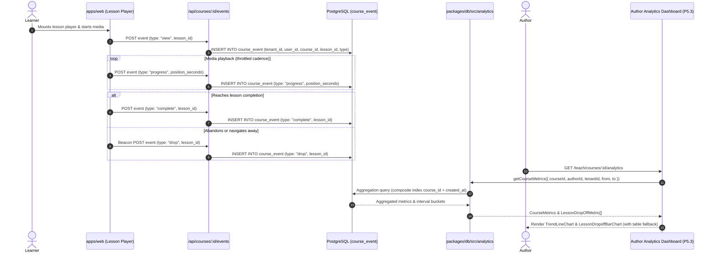

# Feature — author analytics

Status: **partly built**. The event telemetry schema (`course_event`, P5.1) is **merged** in commit `96ea406` (PR #49). The token-styled accessible chart components (`packages/ui/src/charts/`, P5.4) are **merged** in commit `920c782` (PR #63). The aggregation queries (`packages/db/src/analytics.ts`, P5.2) are **implemented** in PR #66. The author analytics dashboard UI (`apps/web/app/(app)/teach/courses/[id]/analytics/`, P5.3) is **planned**.

Cross-links: [architecture](../architecture.md), [data model](../data-model.md), [course authoring](./authoring.md), [player and progress](./player-progress.md), [payments and enrollments](./payments.md), [discovery](./discovery.md), [learner and author profiles](./profiles.md), [ADR-0002 (Postgres / Tenancy)](../adr/index.md), [ADR-0010 (Accessibility)](../adr/index.md), [ADR-0014 (Tenancy model)](../adr/index.md), [2026 Stack Decisions](../decisions/2026-stack-decisions.md).

---

## Status by item

| Item | What | State | Evidence |
|---|---|---|---|
| P5.1 | `course_event` schema & index migration | **merged** | `packages/db/src/schema/event.ts`, `event.test.ts` (#49) |
| P5.2 | Event aggregation & trend queries | **implemented** | `packages/db/src/analytics.ts`, tests in PR #66 |
| P5.3 | Author analytics dashboard UI | planned | `apps/web/app/(app)/teach/courses/[id]/analytics/` (#52) |
| P5.4 | Token-styled accessible chart primitives | **merged** | `packages/ui/src/charts/`, `chart.test.tsx` (#63) |

---

## System architecture & telemetry pipeline

Lagan separates operational state (`enrollments`, `lesson_progress`) from append-only analytical events (`course_event`). The operational tables record current learner progress and entitlement state. The event stream records temporal actions to compute conversion, retention, drop-off, and temporal velocity for instructors.



---

## Core metrics definitions & mathematical models

Every metric in the analytics suite is defined with strict mathematical invariants to ensure consistent reporting across dashboard views, summary cards, and time-series charts.

### 1. Enrolments ($E$)

The total number of learners who have acquired access to the course within the queried timeframe.

$$\text{Enrolments}(t_{\text{from}}, t_{\text{to}}) = \sum [e \in \text{enrollments} \mid e.\text{course\_id} = C \land t_{\text{from}} \le e.\text{enrolled\_at} \le t_{\text{to}}]$$

- **Lifetime enrolments (`totalEnrolments`)**: The cumulative count of all enrollment records across all time.
- **Windowed enrolments (`enrolments`)**: The count of enrollment records whose `enrolled_at` timestamp falls within the filter window $[t_{\text{from}}, t_{\text{to}}]$.
- **Data source**: `enrollments` table, keyed on `course_id`.

### 2. Course starts ($S$)

The count of **distinct learners** who initiated learning activity within the course. A start is identified when a learner triggers at least one `view` event on any lesson or the course root.

$$\text{Starts}(t_{\text{from}}, t_{\text{to}}) = |\{ u \in \text{users} \mid \exists e \in \text{course\_event} : e.\text{user\_id} = u \land e.\text{course\_id} = C \land e.\text{type} = \text{'view'} \land t_{\text{from}} \le e.\text{created\_at} \le t_{\text{to}} \}|$$

- **Why distinct users**: A learner opening five lessons in a day represents one learner start, preventing session reloads from artificially inflating active student counts.
- **Distinction from enrolments**: Enrolment represents financial or administrative acquisition; Starts represents pedagogical engagement. The difference ($E - S$) measures dormant or unstarted purchases.

### 3. Course completions ($C$)

The count of **distinct learners** who completed the entire course curriculum. A course completion event is recorded with `type = 'complete'` and a `NULL` `lesson_id`.

$$\text{Completions}(t_{\text{from}}, t_{\text{to}}) = |\{ u \in \text{users} \mid \exists e \in \text{course\_event} : e.\text{user\_id} = u \land e.\text{course\_id} = C \land e.\text{type} = \text{'complete'} \land e.\text{lesson\_id} \text{ IS NULL} \land t_{\text{from}} \le e.\text{created\_at} \le t_{\text{to}} \}|$$

- **Lesson vs course completion**: An event where `lesson_id IS NOT NULL` tracks completion of a specific lesson component. Only events with `lesson_id IS NULL` signify course-level completion.

### 4. Course completion rate ($R_c$)

The ratio of learners who completed the course to the learners who actively started it.

$$R_c = \begin{cases} \frac{C}{S} & \text{if } S > 0 \\ 0 & \text{if } S = 0 \end{cases}$$

- **Why $S$ is the denominator (not $E$)**: Using starts ($C / S$) isolates educational effectiveness and curriculum retention from purchase conversion. Calculating completion against total enrollments ($C / E$) conflates learner disengagement with buyers who never began the first module.
- **Zero-handling**: If $S = 0$, $R_c$ is strictly evaluated to `0` (or `0.0%`), preventing division-by-zero errors or IEEE 754 `NaN` values from propagating into UI calculation or formatting helpers.
- **Anomalies and bounds**: In standard operation, $0 \le R_c \le 1.0$ ($0\%$ to $100\%$). If windowing filters capture completions from learners whose start occurred before $t_{\text{from}}$, the query window isolates events within the interval; lifetime views clamp to $1.0$.

### 5. Per-lesson drop-off & drop-off rate ($R_{d, l}$)

Per-lesson drop-off measures student attrition at each instructional unit, pinpointing friction points, excessively difficult assignments, or unengaging video modules.

For any published lesson $l$ in course $C$:
- **Lesson Views ($V_l$)**: Count of distinct learners with a `view` event on lesson $l$.
- **Lesson Completions ($C_l$)**: Count of distinct learners with a `complete` event on lesson $l$.
- **Lesson Drop-offs ($D_l$)**: Count of distinct learners who abandoned or exited the course at lesson $l$ (`type = 'drop'` with `lesson_id = l.id`).

$$\text{Drop-off Rate } (R_{d, l}) = \begin{cases} \frac{D_l}{V_l} & \text{if } V_l > 0 \\ 0 & \text{if } V_l = 0 \end{cases}$$

- **Zero-handling**: When a new or unviewed lesson has $V_l = 0$, $R_{d, l}$ evaluates to `0`.
- **Sequential funnel attrition**: Across sequential lessons $l_1, l_2, \dots, l_n$, the step drop-off between consecutive lessons is computed as:

$$\Delta_{\text{step}}(l_k \to l_{k+1}) = \max(0, V_{l_k} - V_{l_{k+1}})$$

---

## Event tracking model — `course_event`

The `course_event` table (`packages/db/src/schema/event.ts`) is an append-only transaction ledger capturing granular learner interactions.

### Relational schema definition

```ts
export type CourseEventType = "view" | "progress" | "complete" | "drop";

export const courseEvent = pgTable(
  "course_event",
  {
    id: text("id").primaryKey(),
    // ADR-0002: every table holding institution data carries tenant_id from migration one.
    tenantId: text("tenant_id").notNull(),
    userId: text("user_id")
      .notNull()
      .references(() => user.id, { onDelete: "cascade" }),
    courseId: text("course_id")
      .notNull()
      .references(() => courses.id, { onDelete: "cascade" }),
    // Nullable: a "drop" or "complete" event can fire at course level, with no lesson in focus.
    lessonId: text("lesson_id").references(() => lessons.id, { onDelete: "cascade" }),
    type: text("type").$type<CourseEventType>().notNull(),
    positionSeconds: integer("position_seconds").notNull().default(0),
    createdAt: timestamp("created_at", { withTimezone: true }).defaultNow().notNull(),
  },
  (table) => [
    index("course_event_tenant_id_idx").on(table.tenantId),
    index("course_event_user_id_idx").on(table.userId),
    index("course_event_course_id_idx").on(table.courseId),
    index("course_event_lesson_id_idx").on(table.lessonId),
    index("course_event_course_id_created_at_idx").on(table.courseId, table.createdAt),
  ],
);
```

### Event types and semantics

| `type` | `lesson_id` | Semantics | Primary use |
|---|---|---|---|
| `view` | `NULL` | Learner visited the course overview / table of contents | General course interest |
| `view` | Set | Learner entered and mounted the lesson player | Lesson start / denominator for lesson drop-off |
| `progress` | Set | Periodic playback position update (`position_seconds`) | Scrubbing, engagement depth, video watch time |
| `complete` | Set | Learner met completion threshold for the lesson | Lesson funnel conversion ($C_l$) |
| `complete` | `NULL` | Learner finished all required lessons in the course | Course completion ($C$) |
| `drop` | Set | Learner exited, closed tab, or bounced during this lesson | Lesson friction / drop-off numerator ($D_l$) |
| `drop` | `NULL` | Learner explicitly abandoned or dropped course enrollment | Course-level attrition |

### Extensible payload model & JSONB evolution

The current schema prioritizes lean, predictable row sizing and fast index inserts by storing `type`, `lesson_id`, and `position_seconds` as direct relational columns. For rich telemetry, the schema accommodates an extensible JSONB payload without breaking existing query indexes:

```ts
// Planned telemetry payload representation for rich events
export interface CourseEventPayload {
  clientSessionId?: string;
  playbackRate?: number;
  totalDurationSeconds?: number;
  seekCount?: number;
  deviceType?: "desktop" | "mobile" | "tablet";
  sourceReferrer?: string;
}
```

- **Storage efficiency**: High-frequency heartbeat ticks (`progress`) generate substantial row volume. Storing `position_seconds` as an `integer` requires 4 bytes on disk, avoiding JSONB parsing and decompression overhead during range aggregations.
- **Payload containment**: When arbitrary metadata is added (`payload: jsonb("payload")`), it carries non-indexed operational context (user agent strings, screen dimensions, audio track language) while core aggregation filters operate on typed relational columns.

### Multi-tenancy & author scoping

Author analytics enforces strict data isolation at two hierarchical boundaries:

1. **Tenant boundary (ADR-0002 & ADR-0014)**:
   Every query mandates `course_event.tenant_id = :tenantId`. Events cannot be read or aggregated across tenant boundaries, preventing institution data leaks in shared-database deployments.
2. **Author ownership boundary**:
   Instructors may only inspect metrics for courses they own. Before executing aggregation queries, the database verifies course authorship:

```ts
const [course] = await db
  .select({ id: courses.id })
  .from(courses)
  .where(
    and(
      eq(courses.id, options.courseId),
      eq(courses.authorId, options.authorId),
      eq(courses.tenantId, options.tenantId),
    ),
  );

if (!course) {
  return null; // Deny access / course not found
}
```

Attempts by an author to query another instructor's course ID return `null` (rendering a 404 or 403 in the dashboard route), neutralizing Insecure Direct Object Reference (IDOR) vulnerabilities.

---
