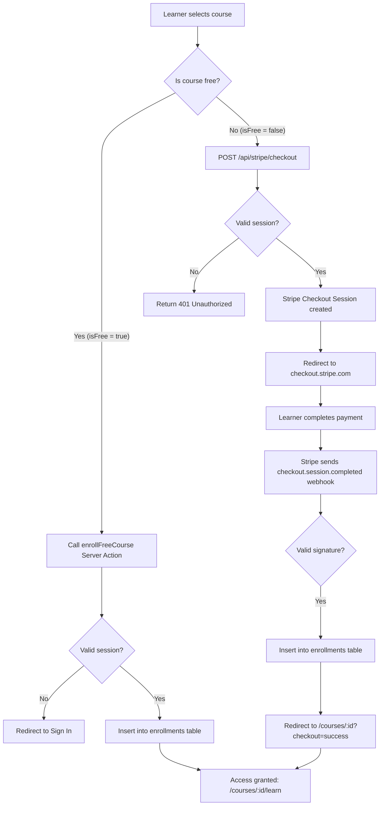

# Feature — course discovery

Status: **partly built** (P3.1, P3.3, P3.5). The catalog browse, search, category filtering, and
view toggle (grid / list) are **merged** in `apps/web/app/(app)/courses/` and `packages/ui/src/`
(commit `7711a4a`, #68), and payments infrastructure is merged (P3.3, #54). Course detail page
(`/courses/[id]`, P3.2), entitlement query helpers (P3.4), and free enrollment path (P3.8) are
**planned**.
Cross-links: [architecture](../architecture.md), [data model](../data-model.md),
[payments](./payments.md), [authoring](./authoring.md), [player and progress](./player-progress.md),
[author analytics](./analytics.md), [ADR-0002 (Postgres / Tenancy)](../adr/index.md),
[ADR-0007 (Managed Video)](../adr/index.md).

## Status by item

| Item | What | State | Evidence |
|---|---|---|---|
| P3.1 | Browse + search + category filter | **merged** | `apps/web/app/(app)/courses/`, commit `7711a4a` (#68) |
| P3.2 | Course detail page (`/courses/[id]`) | planned | tracked as #16 |
| P3.3 | Stripe checkout + webhook | **merged** | `apps/web/lib/stripe.ts`, `apps/web/app/api/stripe/`, `packages/db/src/schema/enrollment.ts` (#54) |
| P3.4 | Entitlements / enrollment query helpers | planned | tracked as #18 |
| P3.5 | View toggle component (grid / list) | **merged** | `packages/ui/src/view-toggle.tsx`, `course-view-toggle.tsx`, commit `7711a4a` (#68) |
| P3.8 | Free course enrollment path | planned | tracked as #22 |

## Discovery surfaces

Discovery spans three primary touchpoints:

1. **Catalog landing page (`/learn`).** Post-authentication landing route defined in `architecture.md`
   and protected by `apps/web/middleware.ts`. Displays published courses matching the learner's
   active search and category filters.
2. **AppShell global search and filter (`apps/web/app/(app)/shell.tsx`).** Persistent header containing
   a search input with `⌘K` keyboard shortcut and a category dropdown. Currently holds local React
   state (`useState`); intended to synchronize with URL search parameters (`?q=...&category=...`).
3. **Course detail page (`/courses/[id]`).** Public and preview landing surface displaying course
   metadata, curriculum syllabus, instructor profile, pricing, and enrollment triggers.

```
+-----------------------------------------------------------------------------------------+
| AppShell Header                                                                         |
| [Search: "rust" (⌘K)]   [Category: "Development" v]   [Notifications]   [User Profile]  |
+-----------------------------------------------------------------------------------------+
| /learn (Catalog Surface)                                                                |
|                                                                                         |
| Controls: [Grid / List View Toggle] (P3.5)   Sort: [Newest v]   Showing: 12 courses      |
|                                                                                         |
| +-------------------------+ +-------------------------+ +-------------------------+     |
| | Course Card             | | Course Card             | | Course Card             |     |
| | Title: Intro to Rust    | | Title: Advanced Tokio   | | Title: WebAssembly 101  |     |
| | Author: Jane Doe        | | Author: John Smith      | | Author: Jane Doe        |     |
| | Badge: $49 (20% off)    | | Badge: Free             | | Badge: $29              |     |
| +-------------------------+ +-------------------------+ +-------------------------+     |
+-----------------------------------------------------------------------------------------+
```

## Catalog and presentation

### Published-only visibility

Discovery queries strictly filter by `courses.status = 'published'`. Drafts (`'draft'`) and archived
courses (`'archived'`) are never exposed to learners. Unauthenticated prospective students and enrolled
learners can see published courses; authors see their own drafts exclusively inside `/teach` (authoring).

### Multi-tenant isolation

Every catalog query must enforce `tenant_id = :tenantId` per ADR-0002. In multi-tenant environments,
courses from one institution or workspace are invisible to learners in another.

### View presentation (P3.5)

The catalog supports two presentation modes:
- **Card / Grid view:** Visual cards emphasizing cover imagery, title, author avatar/name, module count,
  and price or free badges.
- **List / Table view:** Dense view showing course title, author, total lessons, duration, and price in
  a tabular format.

## Search architecture

### Postgres-native full-text search

Per ADR-0002 and stack decisions (`docs/decisions/2026-stack-decisions.md`), search starts inside
PostgreSQL. External search engines (such as Elasticsearch, Meilisearch, or Algolia) are avoided to
prevent synchronization lag, operational overhead, and dual-source-of-truth drift.

```sql
-- Planned tsvector query for published courses within a tenant
SELECT
  id,
  title,
  description,
  price_cents,
  discount_percent,
  is_free,
  ts_rank(search_vector, websearch_to_tsquery('english', :query)) AS rank
FROM courses,
LATERAL to_tsvector('english', title || ' ' || coalesce(description, '')) AS search_vector
WHERE
  tenant_id = :tenantId
  AND status = 'published'
  AND search_vector @@ websearch_to_tsquery('english', :query)
ORDER BY rank DESC, published_at DESC
LIMIT :limit OFFSET :offset;
```

Future optimization: when table sizes grow, add a generated `tsvector` column with a GIN index:
```sql
CREATE INDEX courses_search_idx ON courses USING GIN (
  to_tsvector('english', title || ' ' || coalesce(description, ''))
);
```

### URL-driven state

Search and filter state resides in URL query parameters (`/learn?q=rust&category=development&view=grid`):
- Enables shareable, bookmarkable search results.
- Works cleanly with Next.js Server Components without client-side data synchronization issues.
- Supports browser back/forward history navigation naturally.

## Category filtering and schema gaps

The prototype header in `apps/web/app/(app)/shell.tsx` defines static category options:
`"all"`, `"design"`, `"development"`, `"business"`, and `"marketing"`.

### Schema gap in `packages/db/src/schema/course.ts`

The current `courses` table does not have a `category` column:
- Existing columns: `id`, `tenantId`, `authorId`, `title`, `description`, `priceCents`,
  `discountPercent`, `isFree`, `status`, `version`, `publishedAt`, `createdAt`, `updatedAt`.
- **Requirement for P3.1:** A database migration must add a `category` text column (e.g.
  `category: text("category").$type<CourseCategory>()`) or an associative taxonomy table
  (`course_categories`).

## Course detail page (`/courses/[id]`)

The course detail route serves as both a preview for prospective students and a landing hub for
enrolled learners.

### Content and syllabus preview

1. **Course header:** Title, description, author card (joined from `user` and `profiles`),
   pricing badge, and enrollment action.
2. **Syllabus preview:**
   - Hierarchy of modules and lessons (`modules` joined with `lessons` ordered by `position`).
   - Lesson titles, lesson types (`video`, `text`, `quiz`, `file`, `external`), and estimated runtimes.
   - **Gated content:** Lesson bodies (`content_json`), external links (`external_url`), object keys
     (`file_key`), and Mux playback identifiers (`mux_playback_id`) are withheld until enrollment is verified.

### Action states

The call-to-action button dynamically adapts based on session and entitlement status:

| User state | Course type | Displayed action | Target / Flow |
|---|---|---|---|
| Anonymous | Any | "Sign in to Enroll" | Redirect to `/sign-in?next=/courses/:id` |
| Authenticated | Free | "Enroll for Free" | Calls free enrollment action (P3.8) |
| Authenticated | Paid | "Buy for $X" | Calls `POST /api/stripe/checkout` (P3.3/P3.6) |
| Enrolled | Any | "Continue Learning" | Navigates to player `/courses/:id/learn` (Phase 4) |

### Checkout return handling

`apps/web/app/api/stripe/checkout/route.ts` configures return URLs pointing back to the detail page:
- `successUrl: ${baseUrl}/courses/${course.id}?checkout=success`: Detail page detects `?checkout=success`,
  displays an enrollment confirmation banner, and confirms entitlement via P3.4 query helpers.
- `cancelUrl: ${baseUrl}/courses/${course.id}?checkout=cancelled`: Detail page displays a cancellation
  alert and keeps the user on the course overview.

## Free vs. paid course paths

Lagan supports two distinct enrollment paths:

| Dimension | Paid course path | Free course path (P3.8) |
|---|---|---|
| Course condition | `!course.isFree && course.priceCents > 0` | `course.isFree || course.priceCents <= 0` |
| Initiation endpoint | `POST /api/stripe/checkout` | Server action (e.g. `enrollFreeCourse`) |
| Payment provider | Stripe Hosted Checkout | None (bypassed entirely) |
| Fulfillment mechanism | Asynchronous Stripe webhook (`checkout.session.completed`) | Synchronous database insert |
| Entitlement record | `enrollments` table with Stripe payment ID | `enrollments` table |
| Verification gate | Webhook signature verification (HMAC-SHA256) | User session verification |



### Free enrollment schema challenge

The current schema in `packages/db/src/schema/enrollment.ts` requires:
```ts
stripePaymentId: text("stripe_payment_id").notNull().unique()
```
Because `stripePaymentId` is `notNull()`, a free enrollment cannot insert a null payment identifier.
When implementing P3.8, the team must choose between:
1. **Schema migration:** Alter `stripe_payment_id` to be nullable in `enrollments`.
2. **Synthetic identifier:** Generate a deterministic synthetic ID (e.g. `free_${userId}_${courseId}`
   or `free_${crypto.randomUUID()}`).
3. **Explicit type discriminator:** Add an `enrollment_type` (`"paid" | "free"`) column.

## Trust boundaries and security

1. **Client cannot alter price or status.** The client sends only `{ courseId }`. Pricing and free status
   are evaluated server-side.
2. **Paid courses cannot be bypassed.** `POST /api/stripe/checkout` rejects free courses with `400`,
   while the free enrollment action must reject paid courses (`!isFree && priceCents > 0`).
3. **Syllabus data gating.** Prospective learners inspect module and lesson titles, but video stream
   credentials and lesson documents are excluded from preview API responses until an `enrollments`
   row is confirmed.
4. **Video playback security (ADR-0007).** Assets uploaded to Mux currently use public playback policies.
   Per ADR-0007 and P3.4, video streaming must transition to signed playback tokens issued only
   after verifying active learner enrollment in `enrollments`.
