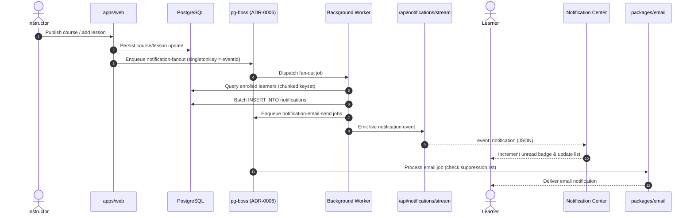

# Feature — notifications

Status: **partly built** (P6.1). Notifications provide durable event records in PostgreSQL, realtime in-app delivery via Server-Sent Events (SSE), background fan-out via `pg-boss` (ADR-0006), email dispatch via `packages/email`, and an accessible notification center in the app shell. The schema and migration (P6.1) are **merged** in `packages/db/src/schema/notification.ts` and `packages/db/drizzle/0002_yielding_gideon.sql` (commit `a90a2f2`, PR #69). The SSE transport (P6.2), fan-out jobs (P6.3), email sending (P6.4), and notification center UI (P6.5) are planned.

Cross-links: [architecture](../architecture.md), [data model](../data-model.md), [course authoring](./authoring.md), [player and progress](./player-progress.md), [payments and enrollments](./payments.md), [discovery](./discovery.md), [author analytics](./analytics.md), [learner and author profiles](./profiles.md), [ADR-0002 (Postgres / Tenancy)](../adr/index.md), [ADR-0006 (Jobs in Postgres)](../adr/index.md), [ADR-0010 (Accessibility)](../adr/index.md), [ADR-0014 (Tenancy model)](../adr/index.md), [2026 Stack Decisions](../decisions/2026-stack-decisions.md).

---

## Status by item

| Item | What | State | Evidence / Tracking |
|---|---|---|---|
| P6.1 | Notification schema (`notifications` table) | **merged** | `packages/db/src/schema/notification.ts`, `0002_yielding_gideon.sql`, commit `a90a2f2` (#69) |
| P6.2 | SSE delivery route & client hook | planned | `apps/web/app/api/notifications/stream/route.ts`, tracked as #32 |
| P6.3 | New-content detection & fan-out dispatch | planned | `pg-boss` background worker, tracked as #33 |
| P6.4 | Email sending integration & templates | planned | `packages/email`, suppression & provider queue, tracked as #34 |
| P6.5 | Notification center UI & bell badge | planned | `apps/web/app/(app)/shell.tsx` popover & unread state, tracked as #35 |

---

## Delivery architecture

Lagan treats **durable database rows as the source of truth** and SSE as an ephemeral transport over them. A dropped network connection or backgrounded tab never loses a notification: unread state persists in PostgreSQL and synchronizes upon reconnection.



---

## Data model — `packages/db/src/schema/notification.ts`

The `notifications` table stores durable notifications for recipients within an institution.

### Schema definition

```ts
export type NotificationType =
  | "course_published"
  | "lesson_published"
  | "enrollment_confirmed"
  | "announcement_posted";

export interface NotificationPayload {
  courseId?: string;
  courseTitle?: string;
  moduleId?: string;
  lessonId?: string;
  lessonTitle?: string;
  enrollmentId?: string;
  actorName?: string;
  url: string;
  message?: string;
}

export const notifications = pgTable(
  "notifications",
  {
    id: text("id").primaryKey(),
    tenantId: text("tenant_id").notNull(), // ADR-0002
    userId: text("user_id").notNull().references(() => user.id, { onDelete: "cascade" }),
    type: text("type").$type<NotificationType>().notNull(),
    payload: jsonb("payload").$type<NotificationPayload>().notNull(),
    readAt: timestamp("read_at", { withTimezone: true }),
    createdAt: timestamp("created_at", { withTimezone: true }).defaultNow().notNull(),
  },
  (table) => [
    index("notifications_tenant_id_idx").on(table.tenantId),
    index("notifications_user_id_idx").on(table.userId),
    index("notifications_user_read_created_idx").on(table.userId, table.readAt, table.createdAt),
  ],
);
```

### Column specifications

| Column | TS property | Type | Null | Default | Notes |
|---|---|---|---|---|---|
| `id` | `id` | `text` | no | — | Primary key. UUID (`crypto.randomUUID()`). |
| `tenant_id` | `tenantId` | `text` | no | — | Tenant boundary identifier per ADR-0002. Indexed. |
| `user_id` | `userId` | `text` | no | — | Recipient FK → `user.id`, `ON DELETE CASCADE`. Indexed. |
| `type` | `type` | `text` | no | — | Discriminator (`NotificationType`). |
| `payload` | `payload` | `jsonb` | no | — | Contextual data (deep link `url`, titles, entity IDs). |
| `read_at` | `readAt` | `timestamptz` | yes | `null` | `null` = unread; timestamp when marked as read. |
| `created_at` | `createdAt` | `timestamptz` | no | `defaultNow()` | Creation timestamp. |

### Constraints and index design

1. **`notifications_user_read_created_idx`**: Composite index on `(user_id, read_at, created_at)`. Serves unread badge counts (`WHERE user_id = :userId AND read_at IS NULL`) and chronological pagination (`WHERE user_id = :userId ORDER BY created_at DESC LIMIT :n`).
2. **`notifications_tenant_id_idx`**: Accelerates tenant-scoped maintenance, partition pruning, and compliance sweeps.
3. **`notifications_user_id_idx`**: Speeds recipient lookups and cascading deletions.

### Read state semantics

Read state is explicitly stored as a timestamp (`read_at`), not inferred from session activity. This guarantees deterministic unread counters across multiple active devices and allows atomic bulk updates:

```sql
UPDATE notifications
SET read_at = now()
WHERE user_id = :userId
  AND tenant_id = :tenantId
  AND read_at IS NULL;
```

---

## Notification types & event triggers

| Notification Type | Trigger Event | Target Audience | Channels | Payload |
|---|---|---|---|---|
| `course_published` | Draft course published | Tenant learners / category followers | In-app + Email | `courseId`, `courseTitle`, `actorName`, `url` |
| `lesson_published` | New lesson or module added | Active course enrollees (`enrollments`) | In-app + Email | `courseId`, `courseTitle`, `lessonId`, `lessonTitle`, `url` |
| `enrollment_confirmed` | Stripe webhook or free enrollment | Enrolled learner (`userId`) | In-app + Email | `courseId`, `courseTitle`, `enrollmentId`, `url` |
| `announcement_posted` | Instructor broadcasts message | Active course enrollees (`enrollments`) | In-app + Email | `courseId`, `courseTitle`, `message`, `url` |

- **`course_published`**: Triggered when a course transitions from `draft` to `published` in authoring (`features/authoring.md`).
- **`lesson_published`**: Triggered when a new lesson is published in an already-published course. Only users in `enrollments` for that `course_id` receive rows.
- **`enrollment_confirmed`**: Triggered during Stripe webhook reconciliation (`features/payments.md`) or free course enrollment (`features/discovery.md`).

---

## Background dispatch, idempotency & fan-out (ADR-0006)

Mass notifications run asynchronously via `pg-boss` (PostgreSQL job queue) to protect HTTP response times.

### Queue structure & deduplication

- **Queues**: `notification-fanout` (batch recipient processing) and `notification-email-send` (provider dispatch).
- **Idempotency singleton**: Jobs use deterministic keys to prevent duplicate fan-outs from rapid retries or replayed webhooks:
  ```ts
  const singletonKey = `${tenantId}:${eventType}:${entityId}:${versionOrTimestamp}`;
  await boss.send("notification-fanout", payload, {
    singletonKey,
    singletonSeconds: 300,
    retryLimit: 3,
    retryBackoff: true,
  });
  ```

### Chunked batch fan-out

For high-enrollment courses, the worker iterates recipients using keyset pagination on `enrollments` (`WHERE course_id = :id AND id > :cursor ORDER BY id LIMIT 500`) and inserts rows using multi-value SQL:

```sql
INSERT INTO notifications (id, tenant_id, user_id, type, payload, created_at)
VALUES ($1, $2, $3, $4, $5, now()), ...
ON CONFLICT DO NOTHING;
```

---

## Server-Sent Events (SSE) route (`/api/notifications/stream`)

In-app notifications stream to browsers via SSE (`apps/web/app/api/notifications/stream/route.ts`).

### Route headers & authentication

```http
HTTP/1.1 200 OK
Content-Type: text/event-stream; charset=utf-8
Cache-Control: no-cache, no-transform
Connection: keep-alive
X-Accel-Buffering: no
```

1. Validates session via `auth.api.getSession({ headers })`. Rejects unauthenticated callers with HTTP 401.
2. Scopes stream strictly to `session.user.id` and `session.user.tenantId`.
3. Disables reverse proxy buffering with `X-Accel-Buffering: no`.

### Wire protocol & frames

1. **Sync frame (`event: sync`)**: Sent upon connect with unread count and latest notifications.
   ```
   event: sync
   data: {"unreadCount": 3, "items": [...]}

   ```
2. **Notification frame (`event: notification`)**: Emitted when a new row is added for the user.
   ```
   event: notification
   id: 8b6a3e50-2d88-4217-91a5-7b561c2df9ef
   data: {"id": "8b6a3e50...", "type": "lesson_published", "payload": {...}, "createdAt": "2026-10-19T05:30:00Z"}

   ```
3. **Heartbeat ping (`event: ping`)**: Emitted every 20 seconds to prevent proxy idle disconnects.
   ```
   event: ping
   data: {"timestamp": 1776576600000}

   ```

### Reconnection & backoff semantics

- **Exponential backoff with jitter**: The client hook reconnects using $t = \min(30\text{s}, 1\text{s} \times 2^{\text{attempt}}) \pm \text{jitter}$.
- **State resync**: Reconnecting clients automatically receive an initial `sync` frame, recovering all notifications missed while offline.
- **Resource protection**: When the client aborts (`request.signal`), server listeners unregister immediately to prevent memory leaks and unbounded buffers.
- **Fallback polling**: If `EventSource` is unavailable or blocked by network proxies, the hook falls back to REST polling (`/api/notifications`) every 60 seconds.

---

## Email delivery integration (`packages/email`)

Email is the asynchronous fallback channel for offline learners.

### Provider abstraction & queueing

`packages/email` defines an `EmailProvider` interface (`send(payload): Promise<{ messageId: string }>`).
- **Production**: Resend or AWS SES API.
- **Development**: Console logger / in-memory collector that records HTML and text to terminal logs without external requests.
- **Asynchronous queue**: Email sends are enqueued as `notification-email-send` jobs in `pg-boss`, never executed inline during web requests.

### Suppression lists & compliance

1. **`email_suppressions` table**: Tracks unsubscribes, hard bounces, and spam complaints by `(tenant_id, email)`.
2. **Pre-flight guard**: Workers verify recipient addresses against `email_suppressions` before sending; suppressed addresses are skipped safely.
3. **One-click unsubscribe**: Outgoing announcement emails include RFC 8058 `List-Unsubscribe` and `List-Unsubscribe-Post` headers.
4. **Plain-text alternative**: All React Email templates generate both semantic HTML and a mandatory plain-text fallback (`text`) for accessibility and deliverability.

---

## In-app notification center UI (P6.5)

### Shell trigger & unread badge

Located in `apps/web/app/(app)/shell.tsx`:
- **Bell trigger**: Header button with accessible label: `aria-label="Notifications, N unread"`.
- **Unread badge**: Displays unread count (capped at `99+`); hidden when count is 0.

### Popover & interaction model

- **Header**: Shows unread count and a "Mark all as read" button.
- **Filtering**: Tab toggle between "All" and "Unread".
- **Items**: Display type icons, unread indicator dot, title, relative timestamp, and deep-link destination.
- **Optimistic mark-as-read**: Clicking a notification or "Mark all as read" immediately updates local state and fires a server action in the background, rolling back on failure.
- **Accessibility (ADR-0010)**: Focus trap inside open popovers, `Escape` key dismissal, `aria-haspopup="dialog"`, and an `aria-live="polite"` region that announces arriving notifications to assistive devices.

---

## Security, tenant isolation (ADR-0002) & throttling

1. **Tenant isolation**: Every database query, job, and SSE connection enforces `tenant_id = :tenantId`. Database rows are protected with PostgreSQL Row-Level Security policies.
2. **User authorization**: All updates enforce `user_id = session.user.id`, preventing cross-account modifications (anti-IDOR).
3. **Throttling**:
   - SSE connections capped at 3 concurrent streams per user account.
   - Authoring save actions debounced (max 1 fan-out notification per course per 15 minutes for minor edits).
   - Mark-as-read API endpoints rate-limited to 60 requests per minute per IP.

---

## Failure modes & error handling

| Scenario | Layer | Response / Outcome | Defense / Recovery Mechanism |
|---|---|---|---|
| Dropped SSE connection | Client transport | Stream terminates | `EventSource` retries with backoff; initial `sync` restores missed items |
| Proxy connection idle timeout | Network | Timeout at 60s | Server sends `event: ping` keepalive every 20 seconds |
| Large course fan-out (10k+ users) | Background worker | High job load | Keyset pagination and chunked batch inserts (500 rows) in `pg-boss` |
| Duplicate author publish clicks | Web / API | Redundant trigger | `singletonKey` deduplication in `pg-boss` discards duplicate jobs |
| Email provider API downtime | Email worker | HTTP 5xx | `pg-boss` retries with backoff; does not block in-app notifications |
| Bounced email or complaint | Webhook | Suppression event | Recipient recorded in `email_suppressions`; future sends skipped |
| Client offline during event | Database | Learner disconnected | Stored row in PostgreSQL guarantees visibility on next login |

---

## Cross-feature integration points

- **[Data model (`docs/data-model.md`)](../data-model.md)**: Schema definitions, foreign keys, and cascading delete policies.
- **[Architecture (`docs/architecture.md`)](../architecture.md)**: Monorepo layout, Next.js boundaries, and SSE streaming.
- **[Course authoring (`docs/features/authoring.md`)](./authoring.md)**: Course publication triggering `course_published` and `lesson_published`.
- **[Payments and enrollments (`docs/features/payments.md`)](./payments.md)**: Stripe webhook reconciliation triggering `enrollment_confirmed`.
- **[Player and progress (`docs/features/player-progress.md`)](./player-progress.md)**: Lesson navigation and deep links.
- **[Author analytics (`docs/features/analytics.md`)](./analytics.md)**: Engagement tracking.
- **[Discovery and catalog (`docs/features/discovery.md`)](./discovery.md)**: Course catalog and enrollment triggers.
- **[Learner and author profiles (`docs/features/profiles.md`)](./profiles.md)**: User profiles and author avatars.
- **[Architecture Decision Records (`docs/adr/index.md`)](../adr/index.md)**: ADR-0002 (Tenancy), ADR-0006 (Jobs in Postgres), ADR-0010 (Accessibility), ADR-0014 (Tenancy model).
