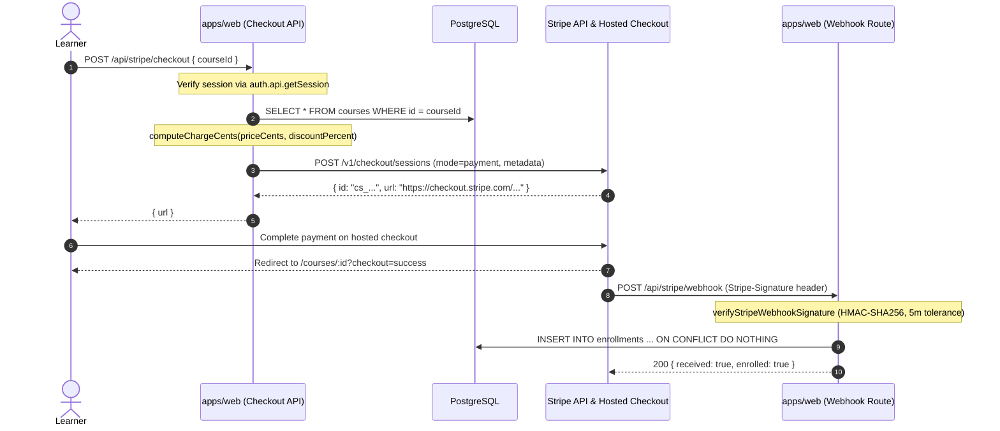

# Feature — payments

Status: **partly built** (P3.3). Stripe checkout session creation, webhook signature
verification, replay-safe enrollment fulfillment, and server-side price computation are
**merged** in `apps/web/lib/stripe.ts`, `apps/web/app/api/stripe/`, and
`packages/db/src/schema/enrollment.ts` (commit `81472af`, #54).

The user-facing checkout triggers (course detail Buy button, P3.2 / P3.6), entitlement access
checks (P3.4), free course enrollment (P3.8), and refund/dispute webhooks are **planned and absent**.

Cross-links: [architecture](../architecture.md), [data model](../data-model.md),
[discovery](./discovery.md), [authoring](./authoring.md), [ADR-0002 (Postgres / Tenancy)](../adr/index.md),
[ADR-0007 (Managed Video)](../adr/index.md).

## Status by item

| Item | What | State | Evidence |
|---|---|---|---|
| P3.3 | Stripe checkout + webhook + enrollment schema | **merged** | `apps/web/lib/stripe.ts`, `apps/web/app/api/stripe/`, `packages/db/src/schema/enrollment.ts`, commit `81472af` (#54) |
| P3.4 | Entitlements / enrollment query helpers | planned | tracked as #18 |
| P3.6 | Buy -> enroll flow (UI triggers) | planned | tracked as #20 |
| P3.8 | Free course enrollment path | planned | tracked as #22 |

## Fulfillment architecture

Fulfillment is asynchronous and decoupled from the client. The browser initiates checkout,
completes payment on Stripe's hosted surface, and is redirected back to the app. Access is
granted only when the verified Stripe webhook delivery reaches the application.



### Trust boundaries

1. **Server-side price authority.** The client never supplies an amount, currency, or discount.
   The checkout endpoint accepts only `{ courseId }`, reads the authoritative `priceCents`,
   `discountPercent`, and `isFree` from the database, and computes the charge via
   `computeChargeCents`.
2. **Signature verification.** The webhook endpoint trusts no payload without a valid HMAC-SHA256
   signature under `STRIPE_WEBHOOK_SIGNING_SECRET`. The signature must match the raw, unparsed request
   body within a 5-minute clock drift window.
3. **Decoupled entitlement grant.** Redirection to `/courses/:id?checkout=success` grants no access.
   The browser cannot forge an enrollment row. Only the webhook's database insert creates an entitlement.
4. **Idempotent replay protection.** Stripe guarantees at-least-once delivery. Network retries or
   duplicate deliveries cannot create duplicate enrollments or overwrite existing records.

## Data model — `packages/db/src/schema/enrollment.ts`

The `enrollments` table records course entitlement for a user:

| Column | TS property | Type | Null | Default | Notes |
|---|---|---|---|---|---|
| `id` | `id` | `text` | no | — | Primary key. App-generated UUID (`crypto.randomUUID()`). |
| `user_id` | `userId` | `text` | no | — | FK → `user.id`, `ON DELETE CASCADE`. Indexed. |
| `course_id` | `courseId` | `text` | no | — | FK → `courses.id`, `ON DELETE CASCADE`. Indexed. |
| `stripe_payment_id` | `stripePaymentId` | `text` | no | — | **Unique**. PaymentIntent ID (`pi_...`) or Checkout Session ID (`cs_...`). |
| `enrolled_at` | `enrolledAt` | `timestamptz` | no | `defaultNow()` | Enrollment timestamp. |
| `course_version_seen` | `courseVersionSeen` | `integer` | no | `1` | Snapshot of `courses.version` at enrollment time. |

Exported bindings: `enrollments` (canonical), `enrollment`; types `Enrollment` and `NewEnrollment`.

### Constraints and indexes

- `enrollments_user_id_idx` on `user_id`.
- `enrollments_course_id_idx` on `course_id`.
- `enrollments_user_id_course_id_key` unique index on `(user_id, course_id)`. A learner can be
  enrolled in a given course at most once.
- `enrollments_stripe_payment_id_unique` unique constraint on `stripe_payment_id`.

Foreign keys to `user` and `courses` specify `ON DELETE CASCADE`. If a user or a course is
deleted, associated enrollment records are removed automatically.

## Client library — `apps/web/lib/stripe.ts`

### `computeChargeCents(priceCents, discountPercent): number`

Pure function calculating net price:
`Math.round((priceCents * (100 - discountPercent)) / 100)`.
Uses `Math.round` (half-up) to produce integer cents. For example:
- 10,000¢ at 50% discount → 5,000¢
- 9,999¢ at 33% discount → 6,699¢
- 10,000¢ at 100% discount → 0¢ (callers reject non-positive amounts)

### `createStripeCheckoutSession(request): Promise<StripeCheckoutSession>`

Issues `POST https://api.stripe.com/v1/checkout/sessions` via native `fetch` with HTTP Basic
bearer authentication (`STRIPE_SECRET_KEY`). Encodes the request as `application/x-www-form-urlencoded`:
- `mode`: `"payment"`
- `client_reference_id`: `request.userId`
- `line_items[0][quantity]`: `"1"`
- `line_items[0][price_data][currency]`: `request.currency` (`"usd"`)
- `line_items[0][price_data][unit_amount]`: computed integer cents
- `line_items[0][price_data][product_data][name]`: course title
- `metadata[userId]`: `request.userId`
- `metadata[courseId]`: `request.courseId`
- `success_url`: redirect URL on successful payment
- `cancel_url`: redirect URL on cancellation

Validates response with Zod: `{ id: string, url: string }`. Throws if HTTP status is not ok or
if `url` is null.

### `verifyStripeWebhookSignature(rawBody, signatureHeader, secret, toleranceMs?, now?): boolean`

Verifies the `Stripe-Signature` header against the exact UTF-8 `rawBody`.
1. Extracts `t=<timestamp>` and one or more `v1=<hex_digest>` entries. Multiple `v1` signatures
   are supported to allow zero-downtime secret rotation.
2. Rejects if timestamp is missing, non-numeric, or drifted beyond `toleranceMs` (default: 5 minutes).
3. Computes HMAC-SHA256 over `${timestamp}.${rawBody}` using `secret`.
4. Compares with `timingSafeEqual` over hex-decoded `Buffer` instances to prevent timing attacks.

### `parseStripeWebhookEvent(rawBody): StripeWebhookEvent | null`

Safely parses JSON and validates basic Stripe event structure:
`{ type: string, data: { object: { id: string, payment_intent?: string, metadata?: Record<string, string> } } }`.
Returns `null` on JSON or schema parse failure.

### `enrollmentIntentFromEvent(event): EnrollmentIntent | null`

Extracts `{ userId, courseId, stripePaymentId }` from a validated event:
- Checks `event.type === "checkout.session.completed"`; returns `null` for all other events.
- Extracts `metadata.userId` and `metadata.courseId`; returns `null` if either is absent.
- Resolves `stripePaymentId` from `payment_intent`, falling back to session `id`.

## API routes

### `POST /api/stripe/checkout` — `apps/web/app/api/stripe/checkout/route.ts`

Initiates checkout session for an authenticated learner:
1. Authenticates session via `auth.api.getSession({ headers: request.headers })`. Returns `401` if missing.
2. Validates JSON payload with Zod (`{ courseId: string.min(1) }`). Returns `400` on invalid payload.
3. Queries `courses` by `courseId`. Returns `404` if not found.
4. Checks free status: if `course.isFree || course.priceCents <= 0`, returns `400 { error: "course is free" }`.
5. Computes net price via `computeChargeCents`. If `amountCents <= 0`, returns `400 { error: "course has no chargeable amount" }`.
6. Resolves base URL from `NEXT_PUBLIC_APP_URL` or request origin.
7. Calls `createStripeCheckoutSession` with success/cancel URLs pointing to `/courses/${course.id}?checkout={success|cancelled}`.
8. Returns `200 { url: checkout.url }`.

### `POST /api/stripe/webhook` — `apps/web/app/api/stripe/webhook/route.ts`

Webhook endpoint receiving Stripe events:
1. Reads `STRIPE_WEBHOOK_SIGNING_SECRET`. Returns `500` if unset.
2. Reads raw request body as text and verifies signature against `stripe-signature` header. Returns `401` if invalid.
3. Parses event payload via `parseStripeWebhookEvent`. Returns `400` if invalid.
4. Extracts enrollment intent via `enrollmentIntentFromEvent`. If `null` (e.g. unhandled event type), returns `200 { received: true, enrolled: false }`.
5. Inserts enrollment row:
   ```ts
   await db
     .insert(enrollments)
     .values({
       id: crypto.randomUUID(),
       userId: intent.userId,
       courseId: intent.courseId,
       stripePaymentId: intent.stripePaymentId,
     })
     .onConflictDoNothing()
     .returning({ id: enrollments.id });
   ```
6. Returns `200 { received: true, enrolled: inserted.length > 0 }`.

### Replay idempotency

Stripe retries webhooks until a 2xx response is returned. Duplicate deliveries are handled safely:
- The `stripe_payment_id` column is unique, and `(user_id, course_id)` has a unique index.
- `onConflictDoNothing()` suppresses constraint violations on replay.
- `inserted.length > 0` returns `enrolled: true` on first write, and `enrolled: false` on replays.
- The route returns HTTP 200 on replays, acknowledging the event so Stripe halts retry loops.

## Failure modes and error handling

| Scenario | Layer | Response / Outcome | Defense / Mechanism |
|---|---|---|---|
| Missing user session | Checkout route | `401 {"error": "unauthorized"}` | Session check via `auth.api.getSession` |
| Malformed checkout body | Checkout route | `400 {"error": "invalid payload"}` | Zod schema validation |
| Non-existent course ID | Checkout route | `404 {"error": "course not found"}` | Database lookup |
| Course marked `isFree` | Checkout route | `400 {"error": "course is free"}` | Rejection; free courses must use free enrollment path |
| 100% discounted course | Checkout route | `400 {"error": "course has no chargeable amount"}` | Guard prevents $0 Stripe checkout sessions |
| Missing `STRIPE_SECRET_KEY` | Checkout lib | Uncaught error (`500`) | `requireEnv` throws explicitly |
| Stripe API error (4xx/5xx) | Checkout lib | Uncaught error (`500`) | Response status check throws descriptive error |
| Missing webhook secret env | Webhook route | `500 {"error": "STRIPE_WEBHOOK_SIGNING_SECRET is not set"}` | Environment check before reading body |
| Missing `Stripe-Signature` | Webhook route | `401 {"error": "invalid signature"}` | Fails signature check |
| Tampered body / wrong secret | Webhook route | `401 {"error": "invalid signature"}` | HMAC-SHA256 mismatch |
| Webhook replay > 5 minutes | Webhook route | `401 {"error": "invalid signature"}` | Timestamp drift check (`toleranceMs`) |
| Malformed JSON body | Webhook route | `400 {"error": "invalid payload"}` | Safe JSON parsing |
| Non-checkout webhook event | Webhook route | `200 {"received": true, "enrolled": false}` | Acknowledged without DB insert to stop retry storms |
| Duplicate webhook delivery | Webhook route | `200 {"received": true, "enrolled": false}` | `onConflictDoNothing()` on unique payment ID and user/course pair |

## Wiring gaps and next steps

- **No checkout button in UI.** Neither `/courses/[id]` nor `/learn` renders a "Buy" button.
- **No pre-checkout duplicate check.** `checkout/route.ts` does not check if the user is already
  enrolled in `enrollments` before generating a Stripe session. A user could pay twice if they initiate
  checkout again.
- **Free course path absent (P3.8).** The checkout route explicitly blocks free courses, but no
  alternative free enrollment action or endpoint exists. In addition, `enrollments.stripe_payment_id`
  is `notNull().unique()`, meaning free enrollments require either a schema migration (nullable column)
  or a synthetic ID scheme (e.g. `free_${crypto.randomUUID()}`).
- **Single currency hardcoded.** `currency: "usd"` is hardcoded in `createStripeCheckoutSession`.
- **Refunds and disputes unhandled.** Only `checkout.session.completed` is handled. `charge.refunded`
  or dispute webhooks are ignored; enrollment revocation is manual.
- **Entitlement checks not wired to player.** The lesson player wrapper (P4.1) exists, but does
  not check `enrollments` before streaming content. Signed playback policies (ADR-0007) are deferred.
