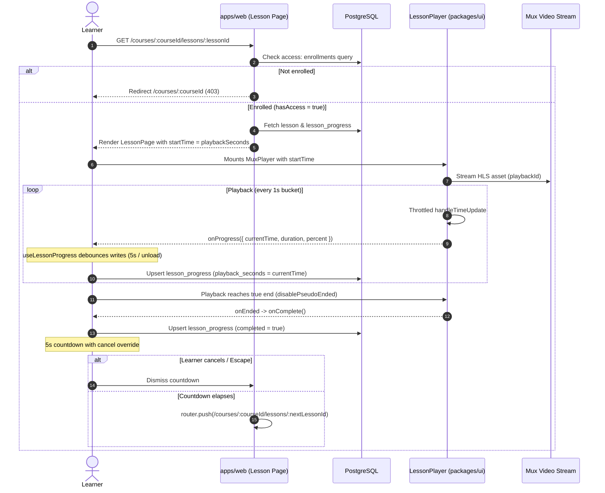

# Feature — player and progress

Status: **partly built** (P4.1). The `LessonPlayer` component (`packages/ui/src/player.tsx`) is
**merged** with token-driven theming, per-second time tracking, and completion signaling
(commit `fd043f4`, PR #57).

The data layer (`lesson_progress` schema, P4.2), client progress hook (`useLessonProgress`, P4.3),
lesson page with poly-type rendering and auto-advance (P4.4), and progress aggregation (P4.5)
are **planned and specified**.

Cross-links: [architecture](../architecture.md), [data model](../data-model.md),
[authoring](./authoring.md), [payments](./payments.md), [discovery](./discovery.md),
[profiles](./profiles.md), [analytics (D5)](./analytics.md),
[ADR-0002 (Postgres / Tenancy)](../adr/index.md), [ADR-0007 (Managed Video)](../adr/index.md),
[ADR-0010 (Accessibility)](../adr/index.md).

## Status by item

| Item | What | State | Evidence |
|---|---|---|---|
| P4.1 | Mux Player wrapper with token theming | **merged** | `packages/ui/src/player.tsx`, `player.test.tsx` (#57) |
| P4.2 | `lesson_progress` schema & migration | planned | #24 |
| P4.3 | Progress tracking hook (`useLessonProgress`) | planned | #25 |
| P4.4 | Lesson page + auto-advance | planned | #26 |
| P4.5 | Course progress aggregation | planned | #27 |

## Lifecycle



---

## Lesson player component — `packages/ui/src/player.tsx`

`LessonPlayer` is a client component (`"use client"`) wrapping `@mux/mux-player-react` (`MuxPlayer`).
It encapsulates video presentation, token theming, progress reporting cadence, and completion
detection, isolating media SDK details from application routes.

### Public interface

```ts
export interface PlaybackProgress {
  currentTime: number;
  duration: number; // 0 while unknown
  percent: number;  // 0..1, 0 while unknown
}

export interface LessonPlayerProps {
  playbackId: string;
  startTime?: number | undefined;
  title?: string | undefined;
  onProgress?: ((progress: PlaybackProgress) => void) | undefined;
  onComplete?: (() => void) | undefined;
  accentColor?: string | undefined;
  themeTokens?: MuxPlayerCSSProperties | undefined;
  poster?: string | undefined;
  autoPlay?: MuxPlayerProps["autoPlay"];
  className?: string | undefined;
}
```

### Design token theming

Per ADR-0004, styling is driven by DTCG tokens (`tokens/tokens.json`) compiled into CSS custom
properties (`tokens.css`). No hard-coded hex colors exist in the player:

- Default mapping: `--media-primary-color: var(--color-surface)`,
  `--media-secondary-color: var(--color-brand)`, `--media-accent-color: var(--color-accent)`,
  `--media-range-bar-color: var(--color-accent)`, `--media-font-family: var(--font-sans)`.
- **Overrides**: `accentColor` overrides `--media-accent-color`; `themeTokens` overrides any `--media-*` property.
- **Frame rounding**: Mux Player web components lack a native border-radius variable. `LessonPlayer` wraps
  `<MuxPlayer />` in a container `div` styled with `borderRadius: "var(--radius-panel)"`, `overflow: "hidden"`,
  and `display: "flex"`.
- **Dark mode**: Styles bind to semantic variables (`--color-surface`, `--color-brand`), so toggling
  `.dark` re-themes player chrome automatically without component re-renders.

### Time tracking & throttling

The media `timeupdate` event fires ~4 times per second. Raw events would flood persistence.

1. **Whole-second bucketing**: `PROGRESS_STEP_SECONDS = 1`. Callback fires only when
   `Math.floor(currentTime / PROGRESS_STEP_SECONDS)` changes.
2. **Seeks**: Seeking jumps to a new integer second bucket, firing `onProgress` immediately.
3. **Unknown duration safety**: `readProgress` clamps `percent` to `0` whenever `duration <= 0`:
   `duration > 0 ? Math.min(1, Math.max(0, currentTime / duration)) : 0`.
4. **Stable callback references**: `onProgress` and `onComplete` are stored in React refs synchronized via
   `useEffect`. Parent re-renders do not re-attach Mux Player DOM elements.

### End-of-video completion logic

- **`disablePseudoEnded`**: By default, Mux Player fires `ended` on scrubs near the timeline end.
  `LessonPlayer` sets `disablePseudoEnded={true}`. Completion is awarded **only** when playback
  naturally plays through to the true end, preventing scrub-skipping exploits.
- **Completion event**: When playback reaches the end, Mux Player emits `onEnded`, calling `onComplete`.

### Accessibility & hotkeys (WCAG 2.2 AA / ADR-0010)

`LessonPlayer` retains standard Mux Player keyboard and caption capabilities by default (tested in
`packages/ui/src/player.test.tsx` verifying `nohotkeys` and `defaultHiddenCaptions` are not passed):

- **Captions / Subtitles**: Enabled automatically when present; `c` toggles subtitles.
- **Keyboard navigation**: `Space`/`k` (play/pause), `ArrowLeft`/`ArrowRight` (seek 5s),
  `ArrowUp`/`ArrowDown` (volume), `m` (mute), `f` (fullscreen).

---

## Planned data model — `packages/db/src/schema/progress.ts` (P4.2)

The `lesson_progress` table tracks per-learner playback positions, completion status, and activity timestamps:

| Column | TS Property | Type | Nullable | Default | Notes |
|---|---|---|---|---|---|
| `id` | `id` | `text` | no | — | PK. App UUID (`crypto.randomUUID()`). |
| `tenant_id` | `tenantId` | `text` | no | — | Multi-tenant isolation (ADR-0002). Indexed. |
| `user_id` | `userId` | `text` | no | — | FK → `user.id` (`ON DELETE CASCADE`). Indexed. |
| `lesson_id` | `lessonId` | `text` | no | — | FK → `lessons.id` (`ON DELETE CASCADE`). Indexed. |
| `course_id` | `courseId` | `text` | no | — | FK → `courses.id` (`ON DELETE CASCADE`). Denormalized. |
| `completed` | `completed` | `boolean` | no | `false` | `true` once completion rule is met. |
| `completed_at` | `completedAt` | `timestamptz` | yes | `null` | Timestamp when completed became true. |
| `playback_seconds` | `playbackSeconds` | `integer` | no | `0` | Stored resume position in seconds. |
| `last_seen_at` | `lastSeenAt` | `timestamptz` | no | `defaultNow()` | Last activity timestamp. |

### Indexes and constraints

1. **`lesson_progress_user_id_lesson_id_key` (Unique index on `(user_id, lesson_id)`)**:
   Enforces one progress record per learner per lesson. Upserts conflict on this pair.
2. **`lesson_progress_user_id_course_id_idx` (Index on `(user_id, course_id)`)**:
   Powers course overview queries, loading all lesson states in one round-trip.
3. **`lesson_progress_user_course_completed_idx` (Index on `(user_id, course_id, completed)`)**:
   Accelerates course completion counting queries (`COUNT(*) FILTER (WHERE completed = true)`).
4. **Cascading deletes**: Removing a user, lesson, or course cascades to progress rows.

### Upsert semantics & monotonic completion

Progress writes use PostgreSQL `INSERT ... ON CONFLICT (user_id, lesson_id) DO UPDATE`:

```sql
INSERT INTO lesson_progress (id, tenant_id, user_id, lesson_id, course_id, playback_seconds, completed, completed_at, last_seen_at)
VALUES ($1, $2, $3, $4, $5, $6, $7, $8, NOW())
ON CONFLICT (user_id, lesson_id) DO UPDATE SET
  playback_seconds = EXCLUDED.playback_seconds,
  completed = CASE WHEN lesson_progress.completed THEN true ELSE EXCLUDED.completed END,
  completed_at = COALESCE(lesson_progress.completed_at, EXCLUDED.completed_at),
  last_seen_at = NOW();
```

**Monotonic completion rule**: Once marked `completed = true`, subsequent playback updates
(such as re-watching from second 0) **must never** revert `completed` to `false` or overwrite `completed_at`.

---

## Client progress tracking hook — `useLessonProgress` (P4.3)

`useLessonProgress` bridges player UI events and server persistence:

```ts
interface UseLessonProgressOptions {
  courseId: string;
  lessonId: string;
  initialPlaybackSeconds?: number;
  initialCompleted?: boolean;
  onCompleted?: () => void;
}
```

- **Optimistic local state**: `handleProgress` updates local state immediately for scrub bars and
  sidebar checkmarks without awaiting server round-trips.
- **Throttled server synchronization**: Writes to PostgreSQL are debounced:
  - Sent periodically every 5–10 seconds during continuous playback.
  - Sent immediately when playback pauses, seeks, or completes.
- **Unload / Visibility flush**:
  - Listens for `document.visibilityState === "hidden"` and `window.beforeunload`.
  - Flushes pending timestamp via `fetch(..., { keepalive: true })` or `navigator.sendBeacon`.
  - Guarantees resume position persistence even if the browser tab is abruptly closed.

---

## Lesson page & auto-advance — `apps/web` (P4.4)

### Route & entitlement gating

- **Route**: `apps/web/app/(app)/courses/[courseId]/lessons/[lessonId]/page.tsx`.
- **Server component gate**: Protected by session check and `hasAccess(userId, courseId)` (P3.4):
  - Non-enrolled users are blocked server-side and redirected to `/courses/[courseId]`.
  - Video streaming playback IDs are never exposed in HTML payloads for unauthorized users.

### Poly-type lesson rendering

Lessons support five types (`lessons.type` in `packages/db/src/schema/course.ts`):

1. **`"video"`**: Renders `LessonPlayer` with `playbackId={lesson.muxPlaybackId}` and resumes from
   `startTime={progress?.playbackSeconds ?? 0}`.
2. **`"text"`**: Renders rich text article formatted with TipTap JSON (`content_json`), sanitized via
   `sanitizeHtml` (`packages/ui/src/sanitize.ts`). Completed via "Mark Complete" button or scroll-to-bottom.
3. **`"quiz"`**: Interactive knowledge check; completed upon achieving a passing score.
4. **`"file"`**: Resource download card for `file_key`; completed on download.
5. **`"external"`**: Outbound link card for `external_url`; completed on link activation.

### Auto-advance behavior

When a lesson is marked complete (via `onComplete` in video or manual completion in text):

1. **Next lesson resolution**:
   - Query adjacent lesson in current module: `lessons.position > currentPosition` ordered by `position ASC LIMIT 1`.
   - If module finished: query first lesson of next module: `modules.position > currentModulePosition` ordered by `position ASC LIMIT 1`.
   - If on the final lesson of the course: show course completion celebration screen.
2. **5-second countdown timer**:
   - Displays a floating toast/modal: *"Next lesson starting in 5s: [Title]"*.
   - Controls: **Play Now** (skips countdown) and **Cancel** (dismisses countdown and stays on lesson).
   - Shortcut: `Escape` cancels auto-advance.
   - Screen-reader announcement: `aria-live="polite"` announces completion and the 5-second countdown.
3. **Navigation**: If not cancelled within 5 seconds, calls `router.push('/courses/[courseId]/lessons/[nextLessonId]')`.

---

## Course progress aggregation — (P4.5)

Course progress aggregates granular `lesson_progress` rows into a single learner completion record
(e.g. *"7 of 10 lessons completed (70%)"*).

### Aggregation contract

```ts
export interface CourseProgressSummary {
  courseId: string;
  userId: string;
  totalLessons: number;
  completedLessons: number;
  percent: number; // 0..100 clamped integer
  isCompleted: boolean;
  lastSeenLessonId: string | null;
  lastSeenAt: Date | null;
}
```

### Edge cases

- **Courses with zero lessons**: When a course has `totalLessons === 0`, `percent` is explicitly
  clamped to `0` to prevent division-by-zero (`0 / 0 = NaN`).
- **Unpublished lessons**: Only published lessons (`lessons.status = 'published'`) count toward the
  total denominator. Draft or archived lessons do not alter completion percentage until published.
- **Unenrolled / unstarted learners**: If a learner has no rows in `lesson_progress`, aggregation
  returns `completedLessons: 0`, `percent: 0`, `isCompleted: false`, and `null` timestamps.

### Database query & index efficiency

Progress aggregation is executed in a single indexed query across `modules`, `lessons`, and `lesson_progress`:

```sql
SELECT
  COUNT(l.id) AS total_lessons,
  COUNT(lp.id) FILTER (WHERE lp.completed = true) AS completed_lessons,
  MAX(lp.last_seen_at) AS last_seen_at
FROM modules m
JOIN lessons l ON l.module_id = m.id AND l.status = 'published'
LEFT JOIN lesson_progress lp
  ON lp.lesson_id = l.id AND lp.user_id = :userId
WHERE m.course_id = :courseId;
```

- **Query optimization**: Uses `modules_course_id_idx` and `lessons_module_id_idx` to identify published lessons,
  and `lesson_progress_user_id_lesson_id_key` to match progress rows without table scans.
- **Cross-feature reuse**: Player drawer checkmarks, My Learning page (`/learning`, P3.7), and
  Author analytics (P5.2 / D5 / [analytics](./analytics.md) completion rate and drop-off metrics).

---

## Security and entitlement gating

1. **Server-side access gating (`hasAccess`)**: Evaluates `hasAccess(session.user.id, courseId)` before fetching
   lesson content. Non-enrolled users are redirected or rejected (`403 Forbidden`).
2. **Preventing stream leakage**: Mux playback IDs are never rendered into HTML for unauthorized users.
3. **Signed playback tokens (ADR-0007)**: While scaffold assets use public policies (`apps/web/lib/mux.ts`),
   production streaming issues Mux Signed Playback JWTs (10-minute TTL) via a protected endpoint.
4. **Idempotent progress reporting**: Upsert writes and completion updates are monotonic and safe under network retries.
